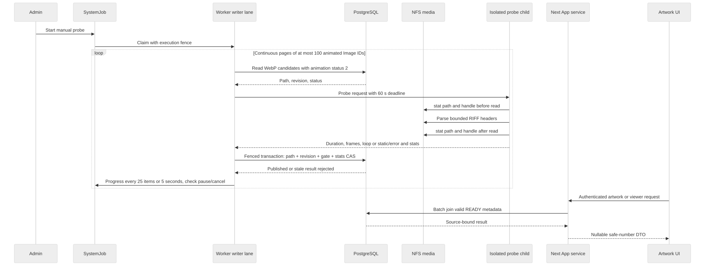

# WebP 动图时长探测

## 需求与边界

本期给已识别为动画的本地 WebP 保存一轮动画的时长、帧数和原文件循环次数，在作品详情与沉浸浏览的播放按钮上显示已播放比例。候选必须是 `.webp` 且 `Image.webpAnimationStatus=2`（已识别为动画）；静态 `1`、待识别 `0` 和未分类 `null` 均不进入时长任务。未分类或待识别 WebP 由现有动画识别任务判型，之后若成为 `2` 就进入时长候选。探测期间源内容变为静态时，解析器仍可记录 `NOT_APPLICABLE`，但不会为了分类而主动读取全部 WebP。GIF/APNG 格式在数据模型中预留，本期不探测。视频继续使用原有 `MediaVideoMetadata.duration`，动画时长不会写进视频字段。

后台探测默认人工启动，计划任务保持关闭。首次上线不自动回填，不做额外整文件哈希，也不让普通页面加载逐文件 stat；已完成且源证据未变的结果在数据库中跳过。真实 NAS 性能和生产发布应分别记录证据，不能从隔离验证推定。

播放控制统一放在作品详情媒体的右下角：红色 capsule 按钮，白色 25% 透明度的进度填充，暂停/继续共用入口；不提供拖动和时间文字。真实暂停冻结当前帧和剩余时长并保留资源；离开当前媒体、下线或销毁时释放资源。数据缺失或失效时不伪造进度，播放器原有加载与兼容回退仍有效。

### 组件关系



[Mermaid 源文件](../diagrams/architecture/animation-duration-probe/components.mmd)

### 读取与发布时序



[Mermaid 源文件](../diagrams/architecture/animation-duration-probe/sequence.mmd)

### 数据模型



[Mermaid 源文件](../diagrams/architecture/animation-duration-probe/data-model.mmd)

## 数据与 API 契约

`ImageAnimationMetadata` 以 `imageId` 与 `Image` 一对一，删除 Image 时级联删除。`format` 预留 `WEBP/GIF/APNG`；`durationMs` 为 PostgreSQL `BIGINT`，一轮所有展示帧的时长总和，不乘循环次数；`frameCount` 为实际动画帧数；`loopCount=0` 表示无限循环；`timingPolicyVersion=1` 表示当前 0–10 ms 帧按 100 ms 计的策略。`status` 是 `PENDING/READY/NOT_APPLICABLE/FAILED`：执行期间仍为 PENDING，因此 Worker 中断后无需清除遗留 PROBING 状态。`probedAt`、`failureCode`、`attemptCount`、`nextRetryAt` 支持审计和有界重试。

源证据为 `sourcePath`、`sourceSize`、毫秒级 mtime/ctime、device/inode（若文件系统提供）、`sourceRevision` 与 `writeInProgress`。源版本由应用内部已知文件变更主动递增，与 `Image.updatedAt` 分离；后者也会因排序、分类和章节变化更新，不可作内容版本。任务使用前后文件状态比较、数据库源版本 CAS 和现有 Worker execution fence 共同阻止迟到结果发布。NFS 外部在同路径、同大小、保留全部时间与 inode 证据的替换无法由轻量方案识别；这不是内容级哈希保证。

API 在每个 `ArtworkImageResponseDto` 和 `ViewerMediaItem` 上返回必填且可空的 `animationMetadata`：

```ts
type AnimationMetadataDto = {
  format: 'WEBP' | 'GIF' | 'APNG'
  durationMs: number
  frameCount: number
  loopCount: number
  timingPolicyVersion: number
} | null
```

只有 `READY`、当前策略版本、未处于写入期、源路径仍等于 Image.path、数值有效且 `durationMs` 能安全转为 JavaScript number 时才非空。返回值不包含源绝对路径、文件统计、内部失败原因或 `BigInt`。列表、详情、随机浏览和邻近作品通过 Prisma 关系批量读取，避免每张图一次查询；已成功的页面读取不逐项访问 NFS。

## 任务与限流

独立任务类型 `ANIMATION_DURATION_PROBE` 运行于现有 `BACKGROUND_WRITER` lane，默认内部并发 1。候选查询、到期失败重试、库存总量与剩余数、失败统计和管理员重试均使用同一已识别动画 WebP 范围。数据库按 Image ID 升序分页，每页最多 100 项；开始时先处理最多 2 个到期失败项，避免低 ID 重试被旧页游标饿死。此后在同一次 Worker 执行中连续分页、逐文件提交探测结果及检查点，直到当前已到期候选全部处理完毕。到达页末时若仍有新识别的低 ID 候选，游标回卷并继续；旧任务检查点仍可恢复。首次领取即刷新旧的 `YIELDING` 快照和全 WebP 库存，处理中每 25 项或 5 秒发布一次进度事件。正常分页不使任务进入 `RETRY_WAIT`。每个文件边界检查取消、暂停和 abort；Worker execution fence、源写入门禁和前后文件状态比较继续生效。单文件最多 60 秒，最多 100,000 个 RIFF chunk，逻辑读取上限 64 MiB，以 4 KiB 缓存处理头部。这里的逻辑读取量是解析器请求字节数，不等于 NFS 物理读流量；解析失败途中可能没有完整测量，失败数单列为 `unmeasuredFailureAttempts`。

只有到期候选耗尽而仍有失败项退避或源文件写入门禁时，任务才保留 attempt 并安排下次领取；这些等待以 INFO 调度事件记录，不产生任务级失败错误。探测到的真实逐项失败仍记录在执行诊断中。探测子进程不可用属于真实资源问题，继续保留错误摘要；暂停和继续不改变已提交的探测检查点。旧任务中的 `YIELDING` 状态和历史静态计数仍可读取，但不会再以正常批次让出 Worker。

Parser 只读原媒体，不解码整帧、不上传或修改文件。按 WebP ANIM/ANMF 记录计算一轮帧时长；0–10 ms 帧按 100 ms，`loopCount=0` 按无限循环保存。已识别动态项若实际内容为静态，标记 `NOT_APPLICABLE` 后不再读；已成功且策略版本未变化的条目直接跳过。瞬时错误最多三次尝试，第一和第二次失败分别等待 1 分钟、10 分钟，第三次停止自动重试；永久格式错误直接终止自动重试。管理员可明确重试失败项，重置退避并递增发布版本。任务跨等待期不能把未到期候选遗漏为已完成；页游标与库存统计必须保持一致。仅剩 `writeInProgress` 候选时，任务进入 `WAITING_SOURCE_WRITE`，持久记录后等待约 10 分钟再检查，而非静默完成；异常遗留门禁须通过上传完成、替换回滚或人工核对处理，任务不会超时自动清除。

文件前后 stat 不一致时记录 `SOURCE_CHANGED` 瞬时失败，只保存失败码、不发布时长，按同一退避策略重试，并继续处理其他候选。应用内部写入先递增 revision，故旧探测发布会因 CAS 拒绝；站外变动只有前后 stat 证据，若两次观察间同名同证据替换则仍可能漏检。

## 源文件变更与恢复

- 本地同 ID 重扫和 Pixiv 同 ID 发布利用发现阶段已有 `lstat` 证据，比较路径、大小、mtime/ctime、device/inode。源证据变化时在 Image 更新事务内使动画结果变为 PENDING 并递增 revision；扫描重新将 WebP 判型设为待识别，识别任务确认动态后才进入时长候选。仅排序、标签或章节变化不使源证据失效。发现阶段不额外读全文件哈希。
- 迁移同 ID 改路径时，发布路径的同一数据库事务使 WebP 结果失效；新 ID 的 WebP 在识别为动态后才成为时长候选。删除旧 ID 会级联删除旧元数据。
- App 分块上传在截断或写入前登记 `writeInProgress`。各 chunk 保持门禁，普通上传只在最后一块完整校验后以捕获的 revision token 清除；异常或中断保留门禁，重试可重新取得版本。迟到的完成操作不能解除较新写入的门禁。
- 扫描可能在 chunk 间观察到暂时的文件大小。扫描比较会跳过活跃门禁；即使其读取到门禁开启前的旧状态，源失效 helper 也会在 Image 行锁下重查门禁，不递增当前 writer 的 revision，也不清除门禁。
- 替换会话在 init 搬移备份文件之前给仍存活的旧 Image 开门禁，final chunk 不解除会话门禁；commit 删除旧 Image 并创建新 ID，rollback 完整恢复旧媒体后用预先捕获的 token 清门禁。同一媒体目录的 init/commit/rollback、图片分块和章节文件写入共用原子目录锁；并发上传等待前一写入，取消的请求不会在排队后继续写。进程崩溃留下的锁不按时间自动夺取，恢复步骤见[备份与恢复](../operations/backup-and-recovery.md)。
- 备份 manifest 记录原文件名、创建时的 size/mtime/ctime/device/inode 证据，以及 `BACKING_UP/READY/ROLLING_BACK/COMMITTING` 阶段。上传仅在 `READY` 阶段继续，且原件同名文件必须已存在于备份中。init 中断后只能搬移身份仍匹配的未备份原件；rollback 删除新文件前核对每个原件，在真实 rename 后中断可依 `restoringFiles` 继续恢复。旧版仅记文件名的 manifest 无法证明未备份目标仍是原件，会保守拒绝自动恢复；缺失、损坏、备份符号链接、源证据变化或提交状态不明时也拒绝猜测回滚。`COMMITTING` 先于数据库提交落盘，因此不能单凭该标记判断提交成功，必须人工比对数据库与媒体。

文件系统写入和 PostgreSQL 事务不是一个原子提交。中断后门禁保守地保持无效结果，需要完成上传、替换回滚或人工核对并恢复；不得直接把旧 READY 结果重新显示。生产原媒体默认只读挂载的 App 中这些旧上传入口可能不可写，但代码仍需维护门禁，因为本地或改挂载部署可调用。

## 验证与恢复入口

候选分类、连续分页、进度节流、源版本 CAS、写入门禁和取消恢复由 DB/Executor 专项测试覆盖；历史结果及未通过的性能门槛见[验证记录](../records/architecture/animation-duration-verification.md)。本页 current 只表示代码核验。

发布按[部署基线](../operations/deployment.md)先部署 migration 再协调 App/Worker 并核对 capability。回退代码可保留新增表及迁移历史；若恢复数据库或媒体必须使用同一检查点。写入门禁异常不能按超时直接清除，恢复见[备份与恢复](../operations/backup-and-recovery.md)。
