# 后台任务业务链路

先读[通用执行机制](./background-jobs.md)理解队列、lane 与 fence；按类型查[任务参考](./background-job-reference.md)。本页解释领域状态怎样随任务推进，不复制注册表数量与版本列表。

## 状态分层

| 层   | 对象                                         | 回答的问题                     |
| ---- | -------------------------------------------- | ------------------------------ |
| 配置 | ScheduledTask                                | 后续应物化哪些计划             |
| 执行 | SystemJob / Event                            | 排队、执行、控制与重试         |
| 领域 | ScanRun、ArchiveRevision、MediaVideoMetadata | 哪些业务项已成功、失败或可恢复 |
| 文件 | staging、原媒体、派生 generation             | 文件是否存在、验证及发布       |

文件存在不证明数据库已经发布；父任务完成也不证明子任务完成。扫描核对见[来源维护](./source-maintenance.md)，视频探测、章节、代表帧与 GC 见[媒体处理](./media-processing.md)。

## Pixiv 作品在线同步链路

[Mermaid 源文件](../diagrams/architecture/pixiv-online-sync.mmd)

网络请求和文件写入不在数据库事务中。最终发布只更新当前 Pixiv ref 能证明拥有的字段；同期调用系列领域核对，系列身份、成员与人工覆盖遵循[系列来源规则](../features/pixiv-series-sync.md)；Artist、媒体、媒体顺序、`Artwork.likeCount` 和本地 metadata 不变。默认保护人工标题和描述，显式“采用最新文本”也使用请求前观测值做并发比较；管理员在任务期间的新编辑优先并令结果进入部分成功。远端标签数组不完整、作品 ID 不符或身份改变时，标签零写入。

快照写入 `pixiv_data/artworks/<pixiv-id>/metadata/<sha256>.json`，数据库仅保存最近哈希和相对路径。作品 JSON 不通过媒体 Route 暴露；完整字段所有权、失败状态和上线规则见 [Pixiv 作品在线同步](../features/pixiv-artwork-online-sync.md)。

## 本地目录导入链路

### 预览阶段仍在 App 中

预览是只读发现，不创建 `SystemJob`：

1. 只进入 `<scanRoot>/local-imports`，第一层目录视为艺术家。
2. 对艺术家目录做深度优先遍历；任意子目录只要包含直属支持媒体，就形成作品候选。
3. 预先读取数据库中 `createdVia=LOCAL_DIRECTORY` 的 `storagePath`。命中已有作品路径后立即标为 existing，并停止深入该目录。
4. 读取艺术家目录映射，返回作品路径、状态和直属媒体数量；不把媒体文件名列表返回浏览器。
5. 限制为深度 12、目录项 100000、作品 10000；浏览器取消请求时中止遍历。

这意味着点击“扫描”仍可能遍历 `local-imports` 中未命中已有路径的目录，但点击“开始导入”不会再次全量遍历 local-imports 根目录。

### 点击开始导入后的流程

[Mermaid 源文件](../diagrams/architecture/local-import.mmd)

关键业务边界：

- 普通导入冻结的是“本次选择的目录列表”，不冻结目录内每个文件，也不计算媒体内容 SHA-256。
- Worker 不重新发现 `local-imports` 根目录，只读取冻结列表中每个作品目录的直属媒体。
- 单作品本地重扫是另一条 `SCAN/ARTWORK_RESCAN` 链路，会计算该作品目录的内容指纹，用于检测排队期间源文件变化。
- “本地目录导入默认标签”在 App 入队时冻结 ID，Worker 发布每个新作品时校验标签仍存在并以 `MANUAL` provenance 写入。
- `media:webp`、`media:video`、`media:image` 是依据作品媒体组成写入的 `DERIVED` 标签，和用户配置的默认标签不是一套语义。
- 任一冻结作品处理失败都会写 `ScanRunItem=FAILED`；本轮存在失败时整个 Executor 会进入失败/重试生命周期，不会把失败悄悄显示成完全成功。

## URL 归档链路

归档的完整页面和保留策略见[归档收件箱](../features/archive-intake.md)。这里强调它与 Worker 的业务流转。

[Mermaid 源文件](../diagrams/architecture/archive-import.mmd)

重要边界：

- submission 只是审计分组，不是必须全部解析完才能继续的封闭批次。
- `ARCHIVE_RESOLVE_ITEM` 做远端解析、数据库冻结及自动模式入队，终态与新下载任务在同一个 fenced 事务中提交；不写媒体目录，因此可以和一个 writer 任务并行。发布锁下重新裁决现有归档，防止自动覆盖已有作品。
- `ARCHIVE_IMPORT` 才下载媒体和发布归档，必须和扫描、本地导入、视频任务共用串行 writer lane。
- “归档默认标签”在 App 手动入队或 resolver 自动创建 `ARCHIVE_IMPORT@v2` 时冻结 ID；Worker 发布归档作品时保留来源标签，并把仍存在的默认标签以 `MANUAL` provenance 幂等追加。旧 `ARCHIVE_IMPORT@v1` 继续按空默认标签执行，避免历史队列失效。
- 归档 `manifest.json` 是 Worker 在归档 staging/revision 中生成的发布清单。它不会出现在普通 `local-imports` 发现链路中，也不会触发本地导入默认标签。
- 网络下载和 FFmpeg/文件流不放进长数据库事务。最终领域发布使用短 fenced transaction，避免失去 lease 的旧执行者发布结果。
- 归档媒体并发从 `Setting.archive_media_concurrency` 读取，默认 2；Executor worker 数和 Provider permit 容量使用同一冻结值。`BACKGROUND_WRITER` 仍只有一个任务执行槽。
- 聚合进度与事件必须在同一 fenced 事务中提交；节流与 SSE 规则见[实时进度](../features/background-job-live-progress.md)。

### 归档维护

`ARCHIVE_MAINTENANCE` 有五种 action：

| Action            | 做什么                                                                |
| ----------------- | --------------------------------------------------------------------- |
| `RECONCILE`       | 有界发现到期 staging、孤立回收/恢复 intent 和到期回收站；只创建子任务 |
| `CLEAN_STAGING`   | 清理一个归档任务的持久 staging intent                                 |
| `TRASH_ARCHIVE`   | 把一个已发布归档移入回收区并推进领域状态                              |
| `RESTORE_ARCHIVE` | 在保留期内恢复一个回收归档                                            |
| `PURGE_ARCHIVE`   | 在路径和状态复核后永久删除到期归档及对应领域记录                      |

因此 `RECONCILE` 父 job 完成只表示发现和子任务物化完成，不表示所有文件维护已经完成。

## 父子任务和完成语义

| 父流程                 | 子任务                                                  | 父任务 `COMPLETED` 表示                | 还必须检查                                 |
| ---------------------- | ------------------------------------------------------- | -------------------------------------- | ------------------------------------------ |
| 视频探测与封面         | 无                                                      | 分类、探测和本轮全部自动封面候选已尝试 | `result` 中单项失败及 `MediaVideoMetadata` |
| 代表帧计划发现         | 每视频一个 `VIDEO_KEYFRAME_GENERATION`                  | 候选发现和子任务物化完成               | 所有 `parentJobId` 子任务和 keyframe set   |
| 归档维护 reconcile     | 每目标一个 `ARCHIVE_MAINTENANCE`                        | 维护 intent 发现和子任务物化完成       | CLEAN/TRASH/RESTORE/PURGE 子任务           |
| 归档收件 submission    | 每 URL 一个独立 resolver job，但不是 SystemJob 父子关系 | submission 本身没有统一执行终态        | 每个 IntakeItem 和 currentSystemJobId      |
| 本地导入/扫描          | 无                                                      | Executor 已按 ScanRun 汇总结束         | ScanRun、ScanRunItem 和 job result         |
| Pixiv 标签/艺术家/作品 | 每个领域实体一个对应补全子任务                          | 全量候选发现和子任务物化完成           | 当前批次的全部子任务终态和领域同步状态     |

任务列表如果只显示父任务，会造成“父任务完成但业务还没完成”的误解。展示层应对代表帧、归档 reconcile 和三类 Pixiv 补全明确显示子任务汇总；视频探测应直接显示同一 result 内的 probe/poster 分段统计。

## 其他领域入口

创作者关系维护和艺术家合并均运行于 writer lane，分别遵守[创作者关系](../features/creator-relations.md)与[艺术家合并](../features/artist-merge.md)的冻结和提交规则。发现来源扫描、标题预览与批量父任务由[发现来源架构](./archive-discovery.md)解释。归档删除/恢复及保留策略以[归档生命周期](../features/archive-lifecycle.md)和[回收站](../features/archive-trash.md)为准。
