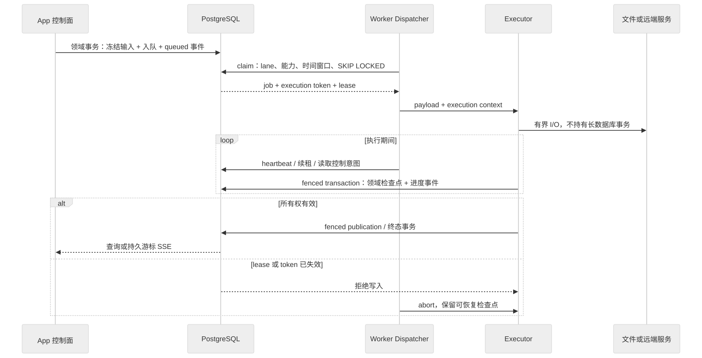

# 后台执行机制

App 负责认证、校验、冻结输入和创建持久任务；Worker 通过 PostgreSQL 领取任务。浏览器、SSE 和 App 进程重启都不拥有任务执行寿命。业务发布边界见[领域链路](./background-job-business-flows.md)，类型和版本入口见[任务参考](./background-job-reference.md)。

## 三条执行通道

一个 Worker 进程运行 `ARCHIVE_RESOLVE`、`ARCHIVE_DOWNLOAD` 与 `BACKGROUND_WRITER` 三个 Dispatcher，各固定并发 1。解析负责远端发现/解析/规则预览，下载负责归档 staging 与完整性校验，writer 负责发布和其他媒体/领域任务。lane 由类型契约推导，调用者不能改派；精确归属以契约和 Registry 为准。

三条 lane 共享进程、数据库连接、网络、挂载与 Provider governor，不构成 OS 资源隔离。归档下载可以与解析及 writer 同时推进；长 writer 仍会阻塞其他 writer。归档内部图片并发默认 2、上限 8，不增加下载任务槽。下载封存与发布的原子交接见[归档生命周期](../features/archive-lifecycle.md)，决策见[ADR-0008](../adr/0008-separate-archive-download-and-publication.md)。

上述串行约束仅覆盖 Worker 领取的 `SystemJob`，不覆盖 App 的直接上传、替换和章节文件写入。执行围栏检查数据库提交的所有权，不阻止或回滚文件 I/O；各领域仍须维护文件锁、staging、intent 与发布验证，维护停写须覆盖全部写入者。

## 生命周期与执行围栏

[Mermaid 源文件](../diagrams/architecture/job-lifecycle.mmd)

[Mermaid 源文件](../diagrams/architecture/job-claim-fence.mmd)

1. App 在领域事务中冻结输入、创建或复用幂等任务并插入事件；Worker 派生子任务同样受当前 execution fence 保护。
2. claim 使用 `FOR UPDATE SKIP LOCKED`，核对 lane、能力版本、资源租约、可执行时间和执行态唯一约束。收件解析项之间额外按 `queueOrder` FIFO。
3. 每次领取建立执行 token、lease 和 heartbeat。进度、领域检查点与终态在验证执行所有权的事务中提交；失去租约的旧进程不能发布。
4. Executor 在文件或项目边界响应暂停/取消并保存检查点；外部进程通过 abort 协作退出。控制请求不代表任意 I/O 可立即中断。
5. 可重试错误按 attempt 和退避进入 `RETRY_WAIT`；资源等待或领域让行可按契约保留 attempt，不等于失败。永久错误或达到上限进入 `FAILED`。

图示是通用状态主线；归档、扫描核对与批次控制必须经过各自领域事务，不能只改 `SystemJob.status`。失败确认只改变“是否需关注”，不篡改失败事实，见[执行记录](../features/background-job-history.md)。

## 计划物化与优先级

内部 scheduler tick 只调用中央 materializer。上海时间 `00:00–08:00` 内按 `scheduledTaskId + scheduledForDate` 幂等物化已启用 DAILY 计划，`availableAt` 为当天窗口开始、`deadlineAt` 为窗口结束；周一才物化派生目录 reconciliation。窗口外不创建当日计划；已开始任务可以完成，过期未开始任务按 deadline 跳过。

旧 `time/defaultTime` 字段和切换开关已退役；不存在回退到 App 内 handler 的分支。优先级决定同窗口内顺序，精确默认配置只维护在[计划注册表](../../packages/pixishelf/services/scheduled-task-registry.ts)。手动“立即运行”不要求计划已启用，也不受每日 deadline 限制。禁用计划只阻止后续物化，不自动撤销已经创建的 job。

手动任务使用较高优先级区间，系统子任务与计划任务使用普通区间；队列包含优先级老化，但不抢占正在运行的任务。不要用任务数量或静态版本计数代替能力审计。

## 观察、恢复与修改入口

- `SystemJob` 保存聚合快照，`SystemJobEvent` 保存持久事件；前端基于事件 ID 追赶并在断线时降级查询。实时进度、节流和保留规则以[实时进度](../features/background-job-live-progress.md)为准。
- 排查按“是否入队 → Worker 能力/lane/时间窗口 → heartbeat 与 stage → 领域结果 → 文件发布引用”顺序进行。`COMPLETED` 仍可能包含逐项失败，父任务也可能只完成发现。归档阶段 HANDOFF 只表示交接，业务成功以当前发布阶段和 ArchiveImport.COMPLETED 为准；列表、分页、统计和 SSE 使用当前阶段聚合，历史阶段在归档详情展开。
- 进程恢复从持久检查点和新 execution token 继续；文件系统写入不受数据库回滚保护，必须使用 staging、发布验证、备份和 GC intent。具体恢复以[运维基线](../operations/backup-and-recovery.md)为准。
- 发布时核对实际 Worker 的类型、definition version 和 lane；维护隔离需停止 Worker，不能使用已删除的兼容开关。见[部署](../operations/deployment.md)。

关键实现：App 的 `services/background-task/` 管命令和计划；runtime 的 `queue-repository.ts` 管领取与 fenced 事务；Worker 的 `dispatcher.ts` 管执行控制；业务 Executor 负责领域检查点与结果解释。历史切换方案保存在[实施归档](../archive/design/background-task-architecture.md)，不作为当前运行手册。

归档聚合、稳定历史游标和当前执行跟随规则见[执行记录](../features/background-job-history.md)，阶段传输与断线补偿见[实时进度](../features/background-job-live-progress.md)。
