# 当前架构

PixiShelf 围绕个人收藏的发现、导入、整理、阅读和恢复构建。Next.js 是交互与任务控制面，PostgreSQL 保存领域事实和持久队列，独立 Worker 执行长任务，文件系统保存原媒体和派生资源。产品边界见[产品基线](../product/product-baseline.md)，术语见[领域语境](../../CONTEXT.md)。

本文的 `current` 表示按当前代码核对，不证明某个构建已发布到生产。

## 运行组件

[Mermaid 源文件](../diagrams/architecture/system-components.mmd)

| 组件        | 职责与边界                                                                                                                         |
| ----------- | ---------------------------------------------------------------------------------------------------------------------------------- |
| 浏览器      | 展示、用户操作和阅读观察；WebP 解码使用浏览器内 Worker，与服务端任务 Worker 无关。                                                 |
| Next.js App | Better Auth 会话、页面、tRPC/HTTP、输入冻结、任务控制与查询；不消费后台队列。另有直接上传/替换文件的入口，是否可写受挂载约束。     |
| PostgreSQL  | 领域数据、账户、任务、租约、进度事件、审计及迁移历史；不保存原媒体二进制。                                                         |
| 通用 Worker | 一个进程内运行解析、下载与发布/维护三个 Dispatcher；各 lane 固定并发 1，writer lane 内的 `SystemJob` 串行，不串行化 App 文件写入。 |
| scheduler   | 调用内部 tick 物化计划任务，不访问数据库或直接执行业务。                                                                           |
| ImgProxy    | 从只读挂载生成图片响应；不生成视频代表帧，不写原媒体。                                                                             |
| 文件系统    | 原媒体、归档 staging/revision、派生媒体与 Pixiv 快照；数据库发布引用后才进入正常读取链路。                                         |

当前是单实例、单信任域部署：可有多个账户，但已登录账户均有实例管理能力。浏览器会话、Webhook、内部 scheduler 和媒体网络入口的门禁分别由[安全基线](../security/access-control.md)定义；隐私遮罩不构成访问控制。

## Workspace 与请求流

[Mermaid 源文件](../diagrams/architecture/package-dependencies.mmd)

| Workspace                  | 负责内容                                                                                     |
| -------------------------- | -------------------------------------------------------------------------------------------- |
| `@pixishelf/next`          | 页面、API、领域服务和任务控制面；源码直接位于包根的 `app/`、`server/`、`services/`、`lib/`。 |
| `@pixishelf/db`            | Prisma Schema、迁移、客户端及跨写入者事务守卫。                                              |
| `@pixishelf/job-contracts` | 任务类型、版本、payload、DTO 和共享媒体分类契约。                                            |
| `@pixishelf/job-runtime`   | 队列、租约、执行围栏、生命周期与持久事件。                                                   |
| `@pixishelf/job-executors` | 扫描、归档、来源同步、媒体处理与维护的业务执行器。                                           |
| `@pixishelf/worker`        | 独立进程、预检、健康服务、能力注册与 Dispatcher。                                            |
| `@pixishelf/webp-player`   | 同源浏览器 Worker、WASM 解码和播放时钟，不依赖任务队列或数据库。                             |

普通请求按“认证 → Zod 输入校验 → 领域服务 → Prisma/文件适配器”流转。长任务在同一领域事务中冻结输入与创建队列记录，浏览器随后通过查询及 SSE 观察结果；关闭页面不会取消持久任务。

Web 通过 TypeScript paths、Vitest alias 和 Next `transpilePackages` 消费 job workspace 源码；独立 Worker 从 DB/job/Worker 包构建，不导入 App 源码。共享包显式 `.ts` 相对导入在独立编译时重写为 `.js`。WebP 预编译解码器随仓库交付，日常构建只校验并准备同源版本化资源，原生工具链说明见[包文档](../../packages/pixishelf-webp-player/README.md)。

## 数据边界与发布不变量

- **本地身份与来源分离。** Artwork 的本地身份不由远端 ID 定义；外部引用、来源快照、人工覆盖和来源关系分别保存。来源刷新必须遵守字段及关系所有权。
- **任务状态与业务状态分离。** `SystemJob` 管执行；`ScanRun`、归档 revision 和派生 generation 管业务结果。任务完成不代表每项成功，也不代表子任务全部完成。
- **文件完成与发布分离。** staging/临时文件写完后仍须验证，再通过短事务切换可见引用。文件系统与 PostgreSQL 没有共同事务，恢复依赖持久 intent、检查点和配套备份。
- **执行围栏保护受检查的数据库提交。** Worker 的领域事务、进度和终态提交核对执行所有权；lease 失效后旧执行器不能通过这些检查。围栏不撤销或回滚文件 I/O，也不串行化 App 的直接文件写入。三个 lane 是 SystemJob 调度边界，仍共享进程和容器文件权限。
- **文件权限与写入协调分别维护。** App 原媒体默认只读，显式允许写入的部署可使用上传、替换和章节写入入口；派生媒体挂载可写，Pixiv data 只读。文件变更需依赖各领域的锁、staging、intent 和发布验证；发布或恢复停写必须停止全部 App、Worker 与外部写入者，具体门禁见运维基线。
- **原媒体内容证据与写入协调。** 受控上传、替换、删除及 Worker 文件发布先建立持久源/路径声明；扫描与指纹提交核对目录代次、源代次和声明，不能把半文件或旧成员发布为完整结果。未知失败保留声明，租约超时不自动证明文件安全。2026-10-23 开发分支局部实现与验收状态分别见[数据库语义](../../packages/pixishelf-db/prisma/database-design.md#原媒体内容证据与写入声明)和[阶段记录](../records/artwork-deduplication-phase-1-2026-10-23.md)。
- **媒体身份变更协调阅读与探测。** 完整重建原子递增媒体版本并失效阅读；同 ID 文件变化失效源绑定的探测元数据。普通排序不能被误判成完整重建。
- **迁移属于部署过程。** Worker 不运行 Prisma migration；应用和 Worker 升级必须遵循[部署基线](../operations/deployment.md)，恢复遵循[备份与恢复](../operations/backup-and-recovery.md)。旧兼容开关已删除，维护隔离通过停止对应服务完成。

## 子系统阅读路线

| 要理解的问题                               | 权威说明                                                                                                                                                                                                                                                                                                               |
| ------------------------------------------ | ---------------------------------------------------------------------------------------------------------------------------------------------------------------------------------------------------------------------------------------------------------------------------------------------------------------------- |
| 怎样调度、领取、暂停、取消与恢复任务？     | [后台执行机制](./background-jobs.md)、[任务参考](./background-job-reference.md)                                                                                                                                                                                                                                        |
| 扫描、导入、视频任务完成意味着什么？       | [后台业务链路](./background-job-business-flows.md)                                                                                                                                                                                                                                                                     |
| Pixiv 增量发现与核对怎样避免破坏整理？     | [来源维护](./source-maintenance.md)                                                                                                                                                                                                                                                                                    |
| 发现来源如何冻结查询、推进游标和接入收件？ | [发现来源架构](./archive-discovery.md)                                                                                                                                                                                                                                                                                 |
| 图片、视频和派生资源怎样读取？             | [媒体处理与分发](./media-delivery.md)                                                                                                                                                                                                                                                                                  |
| 阅读怎样分页、采集和保持账户/版本一致？    | [阅读架构](./reading.md)                                                                                                                                                                                                                                                                                               |
| WebP 怎样解码、回退与释放资源？            | [WebP 播放器](./webp-player.md)、[时长探测](./animation-duration-probe.md)                                                                                                                                                                                                                                             |
| 哪些数据库约束不在 Prisma 中？             | [数据库设计补充](../../packages/pixishelf-db/prisma/database-design.md)                                                                                                                                                                                                                                                |
| 为什么采用这些边界？                       | [ADR-0001](../adr/0001-separate-source-references-from-local-identity.md)、[ADR-0002](../adr/0002-use-a-durable-worker-and-atomic-archive-publication.md)、[ADR-0003](../adr/0003-unify-background-jobs-under-a-durable-single-worker.md)、[ADR-0004](../adr/0004-run-archive-resolution-in-a-separate-worker-lane.md) |
