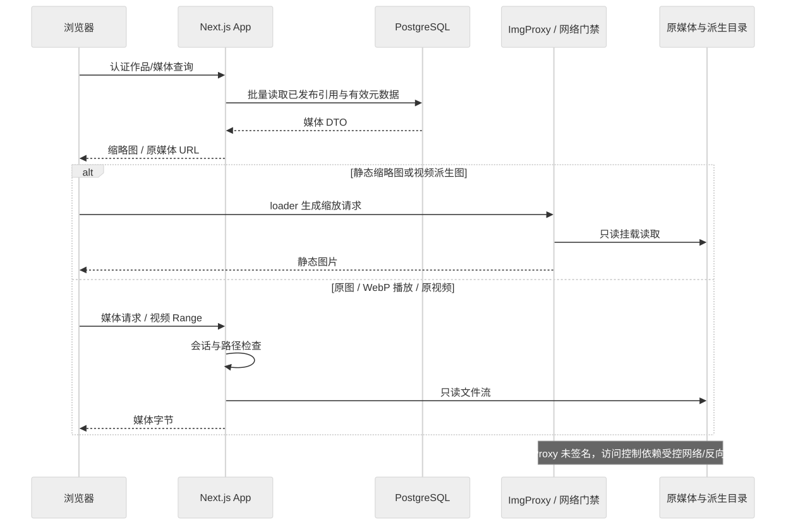

# 媒体处理与分发

静态缩略图、原媒体播放和后台派生生成是三条链路。浏览器通过当前会话读取原媒体；ImgProxy 从只读挂载转换图片；服务端 Worker 提前生成封面、章节图和代表帧。后台生成过程见[媒体处理](./media-processing.md)。

## 读取路径

[Mermaid 源文件](../diagrams/architecture/media-read.mmd)

`lib/image-loader.js` 根据公共 ImgProxy 基址生成缩放地址。普通静态图默认转 WebP，GIF/WebP 缩略图使用静态 JPG，避免列表自动加载整部动画。视频缩略图入口通过 `MediaThumbnail` 选已发布的静态封面；缺封面显示占位。误把原视频送进图片 loader 时返回不可用占位并记录一次调用错误。

派生图片使用 `/_video-posters/`、`/_video-chapter-previews/`、`/_video-keyframes/` 虚拟前缀映射只读派生挂载；URL 版本参数作为缓存键，不能进入本地路径。页面必须依据发布状态及路径构造 URL，文件存在或某父任务完成都不能代替领域发布。

原视频由 `<video>` 读取媒体 URL，GIF/APNG 交互读取原文件；WebP 使用[浏览器播放器](./webp-player.md)。它们不通过 `next/image` 做原媒体播放。图片 API 的范围、路径、会话和缓存处理以代码及[安全基线](../security/access-control.md)为准。

ImgProxy URL 当前未签名，直连端口与反向代理需按安全基线限制；系统图中的图片流不能被理解为 ImgProxy 自带账户认证。App 原媒体默认只读，Worker 可写，ImgProxy 只读；具体挂载真值见 Compose 和[部署基线](../operations/deployment.md)。

## 分类与源一致性

App、扫描、待替换发现与历史 UNKNOWN 分类共用 job-contracts 的 `inferMediaTypeFromPath` / `needsAnimationContentScan`。PNG/WebP 初始为 IMAGE，GIF/APNG 初始为 ANIMATION，四类进入内容探测；状态 1/2 分别确认静态/动画并纠正 mediaType。其他受支持图片不进入动画探测，视频为 VIDEO，未接纳后缀保持 UNKNOWN。

扩展名只提供初始提示，不能覆盖已确认内容。重扫仅在原分类/状态自洽且路径、大小、mtime/ctime/device/inode 证据齐全且未变时复用结果；证据不足或变化重新探测。SVG 沿用接纳规则，AVIF 不因某条视频分类正则而被额外接纳。

待替换的冻结快照保留历史类型，不在读取时重写。PNG/WebP/GIF/APNG 的冻结类型与当前确认结果不同，仅在非 VIDEO 且状态/类型一致时允许作为内容探测纠正；路径、大小、顺序、章节与 hash 校验继续执行。发布或恢复重建媒体显式重置内容探测。此兼容不授权跳过媒体恢复检查点。

时长是独立的源绑定元数据：列表批量 join 有效结果，不逐图访问 NAS；文件变化、写入门禁和发布 CAS 见[动图时长探测](./animation-duration-probe.md)。

## 修改时检查

修改 loader/缩略图要验证静态、动画、视频无封面与派生前缀；修改原媒体入口要验证登录、路径边界及视频 Range；修改分类要覆盖新入库、已确认重扫、冻结旧快照和恢复。资源缓存、API 权限与原文件生命周期不得用一个图片 URL 的成功响应代替验证。
