# 媒体处理与发布

通用调度、租约和取消见[后台执行机制](./background-jobs.md)。本页只解释领域结果和文件发布；读取链路见[媒体分发](./media-delivery.md)，动画时长另见[时长探测](./animation-duration-probe.md)。

## 视频探测与自动封面

### 一个 SystemJob 内的完整流程

[Mermaid 源文件](../diagrams/architecture/video-probe-posters.mmd)

### 状态含义和页面读取

| 字段           | 状态         | 含义                                               |
| -------------- | ------------ | -------------------------------------------------- |
| `probeStatus`  | `PENDING`    | 等待视频元数据探测                                 |
| `probeStatus`  | `PROBING`    | 当前执行正在探测；中断时会恢复或重置               |
| `probeStatus`  | `COMPLETED`  | 元数据可用，可以进入自动封面候选                   |
| `probeStatus`  | `FAILED`     | 本次探测失败；普通计划不重试它，force 重探测会纳入 |
| `posterStatus` | `PENDING`    | 等待自动封面                                       |
| `posterStatus` | `GENERATING` | 当前执行已取得生成所有权                           |
| `posterStatus` | `COMPLETED`  | 数据库已有 `posterPath`，页面可以生成 `posterUrl`  |
| `posterStatus` | `FAILED`     | 本次生成失败；下一次批量探测会再次处理             |

页面和主页不会根据“探测 job 完成”直接显示封面。读取链路要求 `posterStatus=COMPLETED` 且 `posterPath` 非空，随后生成 `/_video-posters/<path>?v=<updatedAt>`；文件再由派生媒体静态路径或 ImgProxy 返回。

当前实现的几个精确边界：

- 批量流程对候选每批取 20 条，但会循环到查询为空，不是最多处理 20 或 100 条。
- 批量流程不创建 `VIDEO_POSTER_GENERATION` 子任务；探测 job 只有在封面阶段结束后才完成。
- 非定向批量任务允许单视频 probe/poster 失败后继续，最终 job 可以是 `COMPLETED`，但 `result.probe.failed`、`result.poster.failed` 和 `failedSamples` 必须如实展示。
- 定向 `force=true + imageId` 重探测如果 probe 失败，会先进入该 job 的重试/失败流程，不继续为这个目标生成封面。
- 有 `manualPosterTimestamp` 的视频不会被自动封面覆盖。
- `hasAudio` 的业务语义是检测到可听内容；音频流存在但 `max_volume=-inf` 或不高于 `-50 dB` 时为 false。
- 匹配章节清单时，20 秒以内扫描整章；更长章节在 25%/75% 附近各扫描 10 秒。无章节时扫描首、中、尾各最多 10 秒。
- FFmpeg 采样失败会使该视频探测失败并可重试，不会以“存在音频流”为 true 兜底。
- `RECHECK_HAS_AUDIO` 不进入封面阶段；已完成且在当前 job 创建时间之后校准的真实有声记录不会在 job 重试时重复处理。
- 批量候选不包含已经 `COMPLETED` 的封面，因此普通探测不巡检几千个历史封面文件是否仍存在。显式单视频封面 Executor 会检查目标 `COMPLETED` 文件是否缺失并重新生成。
- 已发布封面的旧路径、attempt 临时路径通过 `DerivedMediaGcEntry` 管理，不由视频探测直接扫描删除。

## 视频章节预览

[Mermaid 源文件](../diagrams/architecture/video-chapters.mmd)

`INCREMENTAL` 不是只看数据库状态：它会验证预期文件确实存在且是有效 WebP。单章节失败会进入结果统计并继续处理其他章节。

## 视频代表帧

代表帧是用于人工选择或后续能力的派生集合，不等于视频封面，也不会自动改写 `posterPath`。

[Mermaid 源文件](../diagrams/architecture/video-keyframes.mmd)

父 `VIDEO_KEYFRAME_DISCOVERY=COMPLETED` 只表示发现和子任务创建完成。每个视频是否成功必须继续查看 `parentJobId` 指向该父任务的 `VIDEO_KEYFRAME_GENERATION` 以及 `MediaVideoKeyframeSet`。

## 派生媒体 GC

[Mermaid 源文件](../diagrams/architecture/derived-media-gc.mmd)

普通 GC 不会遍历整个派生媒体目录，只处理已经登记且到期的 intent。周一 reconciliation 是只读 dry-run：最多检查 500 个 poster 目录项并报告未跟踪候选，不创建 intent，也不删除文件。

## 其他维护和媒体写任务

### 动画图片识别

`WEBP_ANIMATION_SCAN` 在统计候选前进入 `INITIALIZING`，把符合扩展名且状态为空的记录每批 500 条初始化为 pending；随后进入 `SCANNING`，以 `ANIMATION_SCAN_CONCURRENCY` 控制 1–8 个内部探测 worker（默认 4）。初始化批次以及累计 20 条或最早等待 2 秒的识别批次，都会把领域状态、聚合 `progressData` 和对应事件放在同一个 fenced transaction 中提交。这样进程在领域事务之后、通用结算之前退出时，下一次 claim 仍能从同一任务行检查点恢复准确计数，已连接 SSE 也能通过持久游标接收同一批。WebP/GIF 由同一任务拥有的有界探测子进程池执行 Sharp 输出管线并读取页数：管线设置 60 秒原生超时，父进程另设硬终止兜底；取消、租约丢失和关停会终止对应探测进程并等待退出，不把仍运行的原生操作遗留到下一任务。探测子进程不领取队列任务，也不访问数据库。PNG/APNG 解析签名和 `acTL`；单项超过 10 秒产生一次不含媒体身份的 WARN。失败项留在 pending，后续运行会再次尝试。任务通过 `animation-scan@v1` 展示 30 秒滚动速率、活动数和满足采样门槛后的 ETA。

暂停或取消请求会先让 Dispatcher 停止扩展批次并向 Executor 的 abort signal 传播；已完成的 fenced 微批次保留，未提交结果不会推进领域状态。任务进入 `PAUSED` 后可从同一任务的聚合 `progressData` 恢复原总数与已提交分类计数；恢复初始化会把暂停期间新增的空状态候选纳入总数，并保证 `initializedItems <= totalItems`。失败项仍留在 pending 重新探测且不重复累计；已写入 `COMPLETED` 检查点但尚未完成通用结算的任务保留累计值重放，终态后不得再写入进度或事件。

### 媒体派生标签同步

`MEDIA_DERIVED_TAG_SYNC` 确保三个系统标签存在，然后每批 500 个作品查询媒体路径：有 WebP 加 `media:webp`，有视频加 `media:video`，没有视频加 `media:image`。它只维护 `DERIVED` 关系，不是本地导入默认标签配置。

### 元数据源补全

`REFILL_META_SOURCE` 每批读取 100 个 `metaSource=null` 且有 `externalId` 的作品，从首个媒体所在目录寻找 `<externalId>-meta.txt`，通过根目录和 realpath 校验后补写相对路径。文件缺失和不安全路径进入结果统计。

### 视频流优化

`VIDEO_STREAMING_OPTIMIZATION` 只接受单个 MP4 和 `REMUX_FASTSTART`。Worker 在源目录内创建任务专属临时/备份文件，完成 remux 和校验后再发布；暂停、取消或普通失败尽量恢复原视频。恢复失败会暂停为需要人工处理，而不是把可能损坏的状态标成普通完成。

### 迁移与批量替换

- `MIGRATION` 根据显式 artwork IDs、冻结查询上界或旧失败任务选择作品，为每个文件建立持久计划，先 staging 和校验，再短事务更新数据库路径，最后按 safety 配置清理旧源。逐项检查点支持暂停、重试和失败样本。
- `PENDING_REPLACE` 使用 `pending-replaces`、`.replace-work`、`replace-backups` 和 `completed-replaces` 四类目录。DISCOVER 冻结 manifest 和候选，BATCH 先备份并逐项替换，RESTORE 恢复指定项，CLEANUP 只清理已验证可删除的备份。它与 `local-imports`、归档 revision 都是不同目录协议。

## 实施依据

代表帧最初的数据模型与取舍保留在[历史设计](../archive/design/video-keyframe-generation.md)。该记录中的旧消费者与迁移期字段不作为当前执行依据。
