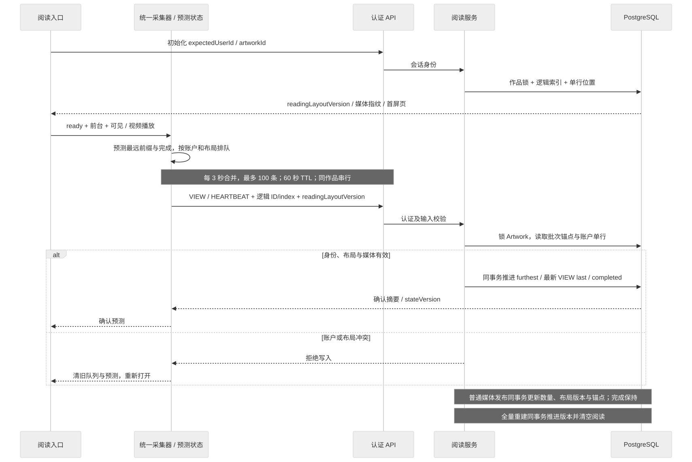

# 阅读架构

阅读系统将真实展示观察、短期客户端预测和账户级持久位置分开。用户语义见[阅读规格](../features/artwork-reading.md)，堆叠展示见[作品堆叠浏览](../features/artwork-summary.md)。本文反映工作区实现，生产部署状态见[本次记录](../records/features/artwork-reading-position-2026-11-04.md)。

## 数据与版本

`Artwork.logicalMediaCount` 缓存完整作品的逻辑媒体数；有序 Image 按 `sortOrder,id` 排列，经共享 `groupLogicalMedia` 合并 APNG/视频后得到完整逻辑序列。分母不使用 Image 行数、渲染窗口、喜欢筛选或堆叠数量。

每个账户/作品只持久化一条 `ArtworkReadingProgress`：最远位置 `furthestMediaId/Index`、最后实际观察位置 `lastMediaId/Index`、粘性 `completed`、访问次数、真实阅读/活动时间和 `stateVersion`。没有逐媒体已读集合。`progressCount` 派生为已完成时的 `totalCount`，否则为最远序号加一，无最远位置时为零；它表达阅读前缀，不声称逐项观察过。

`readingLayoutVersion` 是独立的阅读布局版本，普通媒体顺序、成员、分组或代表项变化时递增；上报与手动完成必须携带该版本。`mediaRevision` 继续服务媒体分页、文件读取及既有内容协议，不能代替阅读布局版本。客户端按 `(readingLayoutVersion,stateVersion)` 采纳摘要，新布局或较新状态可以替换旧状态，迟到响应不能使进度倒退。

## 初始化与媒体分页

`artwork.reader` 在作品锁内读取精简逻辑媒体索引、单行阅读状态和首屏详情；`artwork.mediaPage` 按索引指纹分页获取完整 DTO。索引包含代表项、成员 ID、顺序和占位尺寸，不包含完整文件路径或探测错误。每页 24 个逻辑项；分页在一致快照中核对版本与指纹，冲突要求重开，不能混用新旧页。

客户端 `MediaPageStore` 每会话最多 2 个并发请求、8 页缓存。各入口登记所需页面并释放 pin；预读与加载不构成阅读。初始化允许全量轻量索引随作品规模增长；高频 report 不再加载全量索引，也不枚举旧已读集合。

## 从观察到落库

[Mermaid 源文件](../diagrams/architecture/reading-events.mmd)

完整模式图片区域、适配预览、原图预览与沉浸浏览使用统一采集器，适配层提供 ready、真实可见、前后台和播放观察。图片完整模式可以在下载和解码前记录进入视口的区域；其他预览与堆叠保留加载门槛；视频必须提供播放证据。预加载、被面板遮挡和后台不记读。

队列按账户/作品/阅读布局版本隔离，每 3 秒合并、每批最多 100 个事件、同作品串行发送。事件总寿命为 60 秒，重试不延长；离页及 pagehide 尽力补交，没有持久离线队列。前台有效活动每 60 秒心跳，只延长尚未超时的已有访问，不建立首次访问或移动位置。访问间隔以共享的 30 分钟窗口计次。

`VIEW` 携带逻辑代表 ID、零基 `index` 和观察时间。有效普通观察只向前推进最远位置，最后位置仅由最新有效 VIEW 的观察时间更新，较晚到达的旧观察不能覆盖它。静态堆叠可额外携带 `advanceTo` 的尾项 ID/序号，最远位置推进到尾项，最后位置仍为实际观察项。视频开始计活动，只有播放位置达到有效总时长的 90% 才推进前缀；临时秒数不持久化。

前端先预测待发送和在途观察，再由服务端确认；失败或过期撤回未确认预测。完成提示按账户/作品/布局版本去重。`markRead` 只接受账户、作品和布局版本，将非空作品标为已完成，不伪造最远/最后位置、次数或时间；不再接受单媒体目标、旧 stack/summary 阅读凭据或逐项补记。

## 服务端事务与发布

认证会话提供 `userId`，`expectedUserId` 拒绝过期账户请求。每次报告先锁 Artwork，核对活动状态和 `readingLayoutVersion`，仅加载批次实际提交的媒体锚点及该账户/作品单行状态，校验媒体归属、序号范围、类型和视频门槛后更新。达到逻辑末项即持久化 `completed=true`；完成标记在普通媒体变化后保持。读取卡片摘要与继续阅读直接使用缓存总数和单行状态，不触发隐式进度修复。

普通增删、排序、路径与分组变化由媒体写入者在同一发布事务中调用布局维护：先锁作品并保存旧序列，再写媒体，重建新序列并一次更新缓存总数、布局版本和全部账户锚点。多作品按 ID 升序取锁。锚点先按媒体身份定位，代表项变化沿仍存活的组成员；删除时沿旧序列退到最近仍存续的前项，最远位置没有前项则为空，最后位置没有前项则取新首项。重新定位后的最远位置若成为新末项，也完成作品；已完成状态始终保留。

完整替换、替换恢复或全量重建在原发布事务中清空全部账户进度和访问历史，同时推进媒体版本和阅读布局版本，再发布新逻辑数量。事务失败回滚整套数据库状态；文件系统仍遵守所属写入领域的恢复规则。普通追加不清除已完成标记，完整重建才使旧阅读失效。

## 升级与验证

正式迁移 `20261104010000_reading_position_progress` 原子回填新位置并将旧两表解除全部业务外键后封存到 `reading_legacy_v1`；运行时不读取、升级或双写旧表，也不提供旧客户端阅读协议兼容分支。独立 Android 客户端按用户要求暂停使用，其未完成验收不阻塞 Web/Worker 的新契约发布。旧 90% 完成快照按用户选择保留，其余以当前逻辑序列中的旧已读最远项映射。精确规则、停止条件与独立清理见[位置迁移手册](../operations/runbooks/reading-position-migration.md)。封存数据是迁移证据，不能据此回退旧程序。

验证入口包括 DB 位置维护测试、`prisma/__tests__/reading-position-migration.postgres.test.ts`、服务端阅读测试、`lib/reading/__tests__/` 和 Web/Flutter 组件测试。重点覆盖账户/布局隔离、跳页、回看、完成粘性、最新观察时间、视频、堆叠尾项、媒体发布重定位与失败回滚。实际命令、浏览器与生产限制在[本次记录](../records/features/artwork-reading-position-2026-11-04.md)维护。
