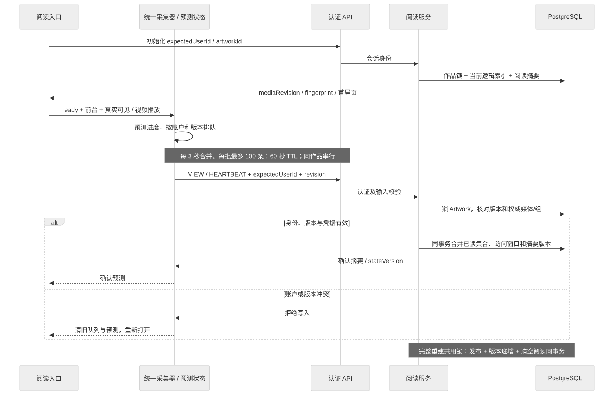

# 阅读架构

阅读系统将真实展示观察、短期客户端预测和账户级持久进度分开。用户看到什么、哪些操作算已读，以[阅读规格](../features/artwork-reading.md)和[堆叠浏览](../features/artwork-summary.md)为准；本页解释实现与一致性。`current` 不代表生产验收完成。

## 初始化与媒体分页

`artwork.reader` 返回精简逻辑媒体索引、阅读摘要及首屏详情；`artwork.mediaPage` 再按索引分页获取完整媒体 DTO。逻辑项沿用 APNG/视频合并规则，索引包含主项、成员 ID、顺序与占位尺寸；不把完整文件路径或探测错误放入精简索引。

每页 `MEDIA_PAGE_SIZE=24` 个逻辑项，服务端同时读取其完整成员。索引指纹覆盖媒体版本、成员顺序、分组和占位尺寸；分页在一致性快照中重算并比较指纹，冲突要求重开阅读上下文，不能混用新旧页。首屏无需加载整部作品的完整 DTO。

客户端 `MediaPageStore` 共用当前阅读会话，最多 2 个并发请求、8 页缓存。各入口登记需要的页与释放 pin；关闭某个入口不取消其他入口所需页面。预读和加载只是资源准备，不构成已读观察。页面失效后停止混入旧结果。

## 从观察到落库

[Mermaid 源文件](../diagrams/architecture/reading-events.mmd)

长图、自适应预览、原图预览与沉浸浏览都接入同一 `ReadingCollector`。适配层只提供当前项、ready、真实可见、前后台及播放状态；被弹层遮挡的底层入口和预加载项不能重复报观看。视频播放观察与图片 ready 观察按共享契约判定，客户端不提交最终次数或任意已读总数。

队列按账户与作品媒体版本隔离。同一作品每 3 秒合并、每批最多 100 个事件并串行发送；间隔与事件 60 秒总寿命由[共享常量](../../packages/pixishelf-db/src/reading-contract.ts)定义，重试不延长寿命。切作品、离页与 pagehide 尝试刷新；网络恢复重新观察，不复活过期事件。有效前台展示每 60 秒心跳，心跳只延长既有活动，不创建新访问或改写最后位置。

前端预测覆盖待发送和在途有效观察；先让进度响应操作，再由服务端摘要确认。摘要按 `mediaRevision/stateVersion` 合并，迟到的旧响应不能覆盖新状态；保存失败或过期撤回未确认预测。首次预测完成反馈按账户/作品/版本去重，不把提示次数当访问次数。

作品完成状态由共享阅读契约的 `getReadingStatus` / `isArtworkReadingComplete` 派生，客户端自动／手动预测与服务端摘要共用，不持久化完成标记或补齐已读集合。具体容错语义见[阅读规格](../features/artwork-reading.md#用户行为)。完成提示的提前检查同样使用共享阈值；首页缓存按新的完成状态移出候选。列表筛选和首页续读 SQL 使用相同百分比常量与整数比较，计数乘法先转换为 `bigint`。续读查询在数据库中按账户、真实活动、作品有效性和未完成条件过滤，再稳定排序并取 6 条，不在取上限后才过滤完成项。

## 服务端事务与账户边界

- 每个读取或写入从认证会话取得 `userId`；`expectedUserId` 是账户一致性条件。查询缓存包含账户，切换账户清空旧队列、取消旧发送并忽略迟到响应。
- 上报先锁 Artwork，核对活动状态和 `mediaRevision`，再加载权威逻辑媒体映射并合并已读成员。普通重复和乱序有效观察按集合合并；活动时间保持单调，较早但仍有效的后到观察仍可更新最后位置。
- 图片/视频分组的分母来自完整逻辑序列；不能以虚拟窗口、只看未读列表、原始 Image 行数或最大观察序号代替。初始化校正摘要但不制造访问。
- 堆叠 VIEW 携带规则版本、索引指纹与组 ID；服务端重新构建组并核验观察媒体，只有服务端计算的成员可获已读。旧摘要凭据继续兼容，但与 stack 互斥；过期或伪造凭据拒绝整批。
- 同批普通观察中已删除/不属于作品的媒体可丢弃，仍有效项目继续合并；作品版本或堆叠凭据冲突不能靠更新客户端版本后重放绕过。
- `markRead` 只修正已读集合，整部目标由服务端查询；不增加真实阅读次数、时间或伪造最后观察。手动修正与上报共用作品锁序。

## 媒体生命周期

普通增删、排序和移动先锁 Artwork 再写 Image，保留存续已读成员；多作品按 ID 升序取锁。下次初始化校正逻辑总数，暂未打开的卡片可显示旧快照。完整替换/重建在原发布事务中递增 `mediaRevision` 并清空所有账户的次数、集合和恢复位置；事务失败不能留下半套状态。

源文件探测 revision 与 Artwork 阅读 revision 是不同概念：前者保护[时长元数据](./animation-duration-probe.md)，后者保护整部逻辑阅读。普通排序不应该使读取变成“新作品”。数据库约束和锁序见[数据库补充](../../packages/pixishelf-db/prisma/database-design.md)。

## 验证入口

- `lib/reading/__tests__/`：统一采集、3 秒合并、串行重试、60 秒过期、账户切换、预测回滚与多入口生命周期。
- `services/artwork-service/__tests__/reader.test.ts` 和阅读集成测试：不同作品规模的首屏上界、24 项分页、指纹冲突及逻辑分组。
- `services/__tests__/reading-service.test.ts` 与 PostgreSQL 集成：并发账户、访问窗口、乱序、手动修正、媒体重建和锁序。
- 堆叠与摘要兼容测试：真实观察授予整组、隐藏成员不伪造观察、伪造/过期凭据零写入。

发布、隔离验证和性能证据跟随[阅读规格](../features/artwork-reading.md)的记录入口。生产行为核验需覆盖真实账户、页面切换及完整媒体重建，不能由单元测试数量代替。
