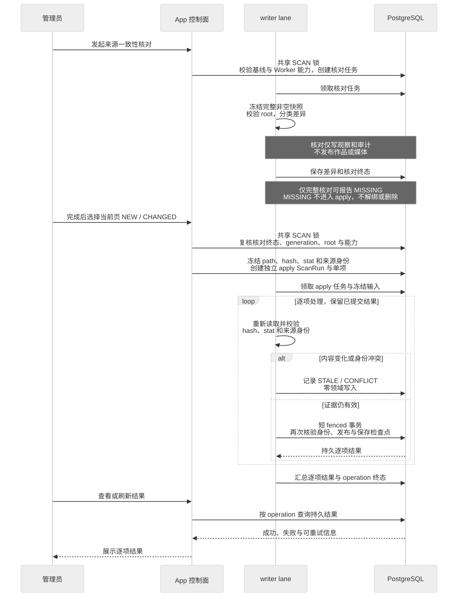

# Pixiv 来源维护

本文描述当前扫描执行机制。在线获取 Pixiv 资料是另一条[来源同步链路](../features/pixiv-artwork-online-sync.md)。当前代码状态不代表生产发布已核验。

## Pixiv 扫描链路

### 入口与模式

- 管理页普通扫描和兼容的 full Webhook 创建 `INCREMENTAL`。
- Webhook `type=list` 创建 `CLIENT_LIST`，对已有来源使用 `SKIP`；公开请求体中的 `force` 字段已退役。
- 单作品重扫创建 `ARTWORK_RESCAN`。
- 破坏性 `FULL_RECONCILE` 已退出 App producer、`SCAN@v1` contract 和 Worker executor；历史终态记录只读保留。

[Mermaid 源文件](../diagrams/architecture/pixiv-scan.mmd)

`ScanRun` 是扫描领域审计，不是第二套队列。`SystemJob` 管执行控制，`ScanRun` 管输入快照、逐项结果、作品/图片数量和耗时。

INCREMENTAL 的目录发现会统计经过的所有目录项，包括媒体文件。Worker 默认用
`SCAN_DISCOVERY_MAX_ENTRIES=10000000` 约束完整遍历；metadata 候选/冻结行另受 100000 行限制。两个上限必须
分开理解：前者防止异常目录无限遍历，后者限制单次数据库快照规模。
遍历默认不进入 SCAN_PATH 根目录直属的 `local-imports`、`sources`、`.archive-staging` 和 `.trash`，避免把本地
导入及归档文件纳入 Pixiv 发现成本；`SCAN_DISCOVERY_EXCLUDED_ROOT_DIRECTORIES` 可提供完整替代清单。

### 来源一致性核对

设置页可以创建 `SCAN@v2` 的 `CONSISTENCY_AUDIT`。App 在共享的 SCAN singleton lock 内复核 Pixiv inventory
baseline 已处于 `READY`、存在新鲜 READY 且声明 `SCAN@v2` 的 Worker，并原子创建 SystemJob、ScanRun 和 queued
event；日常目录扫描、单作品扫描和 Webhook 仍走上面的 `SCAN@v1` 链路，调用方不需要修改。Worker 先冻结完整且
非空的 metadata path/stat 快照，再分类 `NEW / CHANGED / MISSING / INVALID / IDENTITY_CONFLICT /
UNCHANGED`。它只写 operational/audit 记录和 inventory 观测，不发布 Artwork、Image、来源引用、标签、Source
Snapshot 或媒体。

`MISSING` 只允许在完整遍历、未达到安全上限、冻结 count/digest 和扫描 root 身份全部复核通过后，由持有任务
fence 的 finalizer 生成；中断、取消、空目录或 root 变化都不会产生缺失报告。运行中页面只轮询安全摘要；只有
ScanRun 与 SystemJob 都进入 `COMPLETED` 后，独立结果页才开放绑定 run/filter 的 cursor 明细查询。

#### 选定同步

下图按管理员、控制面、Worker 与数据库分泳道；核对只写观察证据，选定同步才允许领域发布。

管理员只可在结果页当前已加载页选择 1–50 个仍为 eligible 的 `NEW / CHANGED`；两类可以用一个“同步所选来源”
动作混合提交。App 在共享 SCAN singleton lock 内重新验证核对已完整完成、inventory generation 未变化、来源根
可用且存在新鲜 READY 的 `SCAN@v3` Worker，然后原子创建 `SCAN@v3 / AUDIT_APPLY`、独立 apply ScanRun、冻结输入
和 PENDING 单项。`sourceAuditRunId` 只保存父核对的证据 ID，不建立可跟随变化的领域外键。

[Mermaid 源文件](../diagrams/architecture/pixiv-audit-apply.mmd)

apply 不是 `CLIENT_LIST` 的别名。v3 Executor 逐项重新比较 metadata 内容、stat、inventory、ExternalRef 和 Artwork
身份；stale 或冲突项目零领域写入，其他项目可以继续，因此一次 job 可以完成但包含逐项失败。页面刷新后从
operation ID 恢复持久结果。一个核对项已经 APPLIED、非 stale SKIPPED、STALE、CONFLICT 或永久失败后不能从同一
核对重复提交；只有可重试失败（例如媒体在核对后暂时缺失）能在修复后从同一核对再次提交。`MISSING / INVALID /
IDENTITY_CONFLICT` 永不进入 apply，`MISSING` 也永不触发解绑或删除。

普通 Pixiv 扫描和 v3 apply 共用 publisher。成功发布会更新 `ArtworkExternalRef.metadataHash`，并按 metadata hash
追加或复用不可变 `ArtworkSourceSnapshot` 的规范化与原始来源证据。刷新只更新来源拥有的数据：尊重标题/描述
override，保留 Artist、MANUAL/DERIVED、未被当前来源再次确认的 LEGACY 与其他来源标签、现有媒体顺序，不删除不再出现的媒体。当前 Pixiv 元数据明确包含的同名 LEGACY 标签会认领为该 Pixiv 引用的 SOURCE 标签。

`AUDIT_APPLY` 对取消与保留有额外的证据完整性约束：

- PENDING、RETRY_WAIT 或 PAUSED 的 v3 apply 被直接取消前，命令层先验证 job payload、apply ScanRun、冻结输入与
  单项集合完整；随后在同一事务中取消 job 和 ScanRun，把未完成项记为可重试的 `OPERATION_CANCELLED`，并保留
  已完成项。
- RUNNING apply 先进入 CANCELLING，由 Executor 在 fence 下终态化尚未完成的项目和 apply ScanRun；任务完成前
  不能留下没有逐项结果的终态 operation。
- `SCAN_RUN_RETENTION_CLEANUP` 在共享 SCAN lock 内复核核对/apply 关系。父核对存在非终态 apply 时整组保留；
  只有父核对符合过期或溢出条件且关联 apply 都终态时，才删除父核对及这些终态 apply，避免留下无证据来源的
  operation 或过早删除核对证据。

## 根身份、库存与历史

根身份使用 `.pixishelf-root` 稳定 UUID，路径变动不得使另一个媒体根复用既有库存；重挂载、旧库绑定与标记恢复见[扫描根身份](../features/pixiv-root-identity.md)。inventory 区分观测 hash 与已发布 hash；只有领域发布和 processedContentHash 在同一 fenced 事务提交，才能标记处理完成。首次建立可信基线后仍枚举并 stat，但仅新文件、指纹变化和可重试失败读取内容。

回滚、旧 FULL 队列审计及实施证据保留在[历史设计](../archive/design/pixiv-source-maintenance.md)，当前升级操作以[部署基线](../operations/deployment.md)为准。
