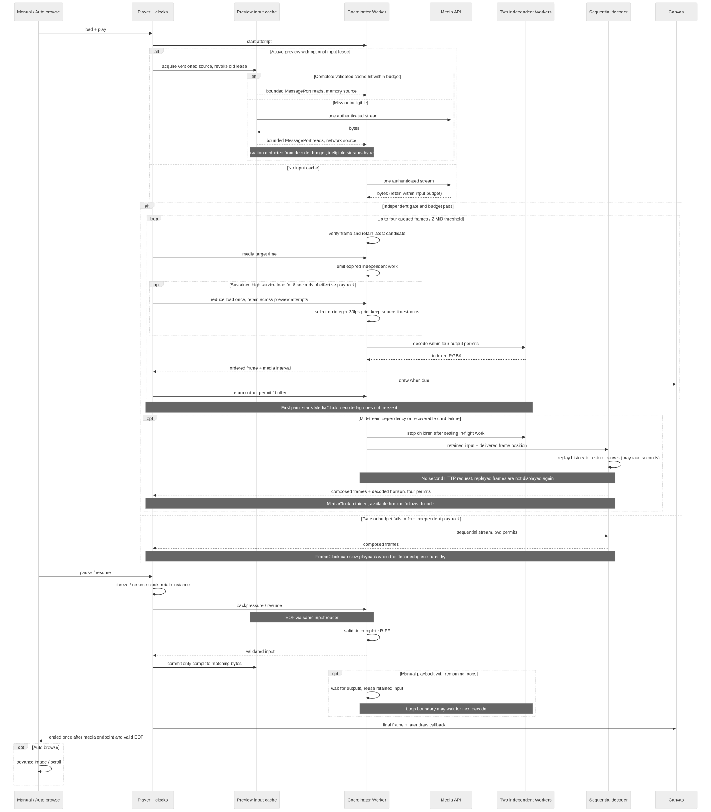

# WebP 播放器架构

`@pixishelf/webp-player` 是默认接入手动播放和自动浏览的私有浏览器库，不需要部署开关。它使用同源 Worker/WASM 将原 WebP 解码到 Canvas；本文中的 Worker 均在浏览器内，不领取服务端 SystemJob。构建与工具命令见[包说明](../../packages/pixishelf-webp-player/README.md)。

## 组件与播放路径

[Mermaid 源文件](../diagrams/architecture/webp-streaming-player/classes.mmd)

| 层                        | 职责                                                                              |
| ------------------------- | --------------------------------------------------------------------------------- |
| React 适配器与预览会话    | 将手动/自动浏览意图传给播放器，处理活动预览、账户变化、回退和资源释放。           |
| WebpPlayer 与时钟         | 首帧、暂停、播放、结束及 Canvas 绘制；媒体时间与帧呈现时间分开。                  |
| 协调 Worker               | 流式读取、容器校验、预算、逐帧独立性门禁、输出额度和回退。                        |
| 独立解码子 Worker         | 两个子 Worker 并行解码合格 VP8 帧，按顺序交付，最多四个输出额度。                 |
| 顺序 libwebp 合成器       | 处理依赖、局部、透明和清除帧；复用上游动画合成逻辑。                              |
| 资源版本缓存 / 压缩输入池 | 前者仅缓存静态 manifest；后者只在活动预览内受预算保存完整压缩媒体，生命周期不同。 |

快速路径逐帧验证全画布、不透明、直接 VP8、flags 为 0 或 2 且不清除；不会先下载整图才决定。实际落后时可省略过期的独立解码工作，保持所选帧的原尺寸与像素。透明、局部或依赖帧走顺序合成，不能省略必要历史。

未知可忽略顶层块以及未声明的 ICCP/EXIF/XMP 可跳过；已声明元数据走保守顺序入口。非法动画顶层图像块、重复 VP8X 和过短 ANIM 等属于错误，不通过重新下载来“修复”。精确门禁由共享解析器维护，覆盖率扫描复用同一门禁。

## 时钟、回退与状态

[Mermaid 源文件](../diagrams/architecture/webp-streaming-player/sequence.mmd)

[Mermaid 源文件](../diagrams/architecture/webp-streaming-player/states.mmd)

- `load` 在首帧可用时完成；`play` 登记播放意图，`pause` 保留时钟和资源，`restart` 开始新请求，`destroy` 幂等释放。旧播放尝试的迟到消息不能影响新实例。
- 独立路径从首帧开始使用媒体时间轴；解码落后不冻结时间。真正输入等待限制可用区间；直接顺序入口使用帧时钟，队列耗尽可以导致慢播。
- 中途遇到依赖帧或可恢复子 Worker 故障时，复用已收压缩字节，重放历史恢复合成画布；不重复 HTTP 下载或重新显示已交付画面。回退可能需要数秒，保留媒体时钟并用已解码区间限制推进。
- 只有合法 EOF、末帧时长结束且末帧得到后续绘制机会，才发出一次结束事件。数据库时长仅作进度分母，不能作为 EOF 或跳帧完成依据。当前时序策略把 0–10 ms 帧按 100 ms 归一化，兼容 Blob 路径与时长探测须使用相同规则。
- 手动播放遵循文件循环次数，0 表示无限；自动浏览只播一轮。播放器暂停保留资源，应用某个入口的“停止并回海报”操作是适配层行为；关闭、离屏或换素材释放，不能把停止当续播。
- 库无法继续且允许兼容回退时，适配层提示原因与完整下载/从头播放代价。初始化、格式、网络、授权错误仍须区分，不能把所有错误自动忽略。

## 持续负载与资源预算

独立路径观察源帧率和解码服务耗时，持续高负载累计有效媒体推进时间后可降至约 30fps。策略只省略已经确认独立的帧，不缩图、不降像素精度或插帧。选帧使用整数网格，输出的可选 `presentationMs` 区分源画面位置与呈现截止时刻，不能通过改变媒体总时长掩盖卡顿。

压力会话在同一次预览跨切图保留，低帧率素材不继续减半；关闭预览、离开作品或账户变化重置。同实例只降不升；长时间隐藏/停止触发下次尝试重新校准，不在暂停实例中途升档。精确阈值以 `playback-pressure.ts`、`decode-cadence.ts` 和回归测试为准，实验选择依据见[手机验证记录](../records/architecture/webp-mobile-verification.md)。

`playerLimits()` 按视口设置压缩输入、画布、WASM 堆及受管内存上限。独立路径预算包含两块解码堆、压缩输入、临时输入及输出帧；只有预算通过才给四个额度，中途顺序回退继续计入已有资源。视口并不等于设备内存，受管预算也不是浏览器 RSS/GPU 总上限。

活动预览的 `CompressedInputCache` 只复用有版本的同源完整 HTTP 200、明确合法长度且通过头部/内存门禁的输入。它保存压缩字节，不保存 RGBA，不持久化，不后台预下载；Worker 确认容器有效 EOF 后才变为可复用条目。HTTP reader 完成不等于内容已通过验证。

输入池按实际 backing buffer 计费，并从当前解码预算扣除桥接和缓存占用。容量不足时淘汰未借出完整条目或放弃新复用，不能突破预算，也不应让原本可播放的素材因缓存被迫失败。命中仍需送入 Worker/WASM 解码，只减少重复正文传输。

缓存键包含账户、登录代次、作品作用域与完整版本 URL。同一作用域仅一个活动 lease；切图取消旧读取、半截输入不保留。隐藏清理未借出条目，关闭预览、pagehide、离开作品或账户失效清空；错误或撤销后的迟到消息不能恢复条目。输入来自网络或内存都经过有背压的同一读取接口。

## 构建、验证与发布证据

固定 libwebp/工具链生成的 scalar 与 SIMD 预编译产物随仓库交付；日常 dev/build 校验 manifest 和哈希，准备同源版本化静态资源。浏览器仅在开始播放时请求所选解码器。SIMD 初始化失败可尝试 scalar，不依赖线程或 SharedArrayBuffer。原生升级需重新做上游结构审查、差分、ASan/UBSan 和真实 WASM 回归。

包内测试覆盖像素对照、流式首帧、有效 EOF、循环、暂停、回退单请求、预算、缓存淘汰与账户隔离；真实手机测试覆盖持续吞吐、动作观感、温控与进程内存。性能测试独立运行，不能与构建争抢 CPU 后当成无负载基线。

- [初次流式接入与构建验证](../records/architecture/webp-streaming-verification.md)：保留早期版本和未通过门槛。
- [独立帧、持续播放与手机验证](../records/architecture/webp-mobile-verification.md)：保留原始时点、样本、资源版本、数值和人工确认；包括十分钟持续播放及压缩复用证据。
- [实验工具](../../packages/pixishelf-webp-player/experiments/README.md)：受控本地复测方法，私人素材和原始报告不入仓库。

`webpDiagnostics=1` 只在登录后的详情入口显示诊断，报告保存在页面内存、不上传；Canvas 调用间隔不是屏幕呈现。移除参数并刷新关闭诊断。实际部署还需结合登录、React 弹窗与反向代理核验，历史手机验收不能证明所有设备、文件或当前生产镜像。
