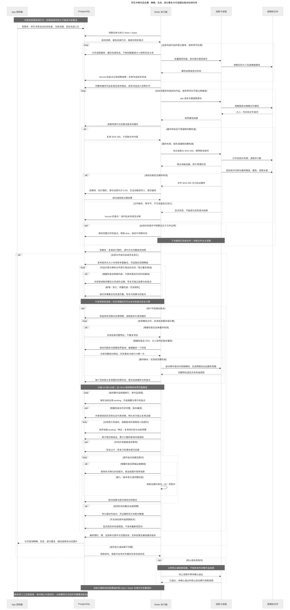

# 同艺术家作品去重

系统检查**同一艺术家**的作品，找出完全相同、完整包含、部分重复及可选的疑似版本，交给用户对照和选择，再将明确待删作品交给普通作品管理删除规则处理。支持本地创建、Pixiv 导入、本地导入、URL 归档四来源及混合组。检测不删除文件，预览不构成删除授权。

本文是当前行为入口。`current` 表示已按所列代码核对，**不代表某个 NAS 或生产实例已部署**；发布和实例验证须有对应记录，不能从版本标签推断。

2026-10-29 局部核验范围：混合媒体、快速确认及 v8 内存检索、覆盖缓存和统一阶段进度；本轮环境与未覆盖项见[实施记录](../records/artwork-deduplication-visual-search-v2-2026-10-29.md)，其余章节沿用先前核验。

2026-10-30 热检查前置批处理与无内容读取执行片的调度改动，详见[本轮实施与验收记录](../records/artwork-deduplication-hot-check-2026-10-30.md)；记录中的完成状态和隔离实测不代表生产已更新。v9 增加整轮热检查批处理与独立结果复用，本轮验收进展见[整轮复用记录](../records/artwork-deduplication-hot-run-reuse-2026-10-30.md)。

| 状态     | 范围                                                                                                                                                                           |
| -------- | ------------------------------------------------------------------------------------------------------------------------------------------------------------------------------ |
| 已实现   | 四类关系、人工对照、统一勾选混批、一次普通删除确认；F01 部分重复闭环、F02 三层缓存；F03 分段与分轮继续；扫描 v9 沿用内存距离检索，增加资料批量核对与整轮结果复用；统一阶段进度 |
| 待完成   | 当前算法的 50 万规模完整验收、真实图片读取／解码及 NAS 并发测量、结构性硬上限后的扩展方案、提高公开范围上限；F04 真实有码／无码版本效果真值验证                                |
| 明确不做 | 自动判断哪部无码、自动保留或合并图片、合并个人整理记录；去重专用隔离／移动／恢复协议及移动端专用适配不再新增；URL 归档仍按普通规则回收                                         |

去重管理以桌面为维护与验收目标，现有窄屏兼容保留；日常浏览和阅读的移动端支持不变。视觉检查当前每次最多 **10,000 个登记原件**，并有单作品、候选和单图限制；这不承诺 10,000 张静态图一定完成，也不限制 SHA 精确／包含／部分重复阶段。详见[处理上限](#处理上限与继续执行)。

## 用户完整流程

[图源](../diagrams/features/artwork-deduplication/business-flow.mmd)。流程依据为[检测服务](../../packages/pixishelf/services/artwork-dedup-service.ts)、[审核服务](../../packages/pixishelf/services/artwork-dedup-review-service.ts)和[共享普通删除核心](../../packages/pixishelf-job-executors/src/artwork-delete/delete-artwork.ts)。

艺术家页“检查重复”进入 `/admin/duplicates?artistId=…`，用户主动开始后冻结当时有效归属的活动作品；后来新增作品留待下次。同一艺术家只允许一个活动检测，暂停也占用资格。默认“快速检查”，可在“检查选项”选择逐一重查或开启“检查疑似版本”，后者默认关闭。关闭浏览器或离开页面不停止后台任务。

### 四类关系如何处理

| 关系     | 判定与对照                                                                                                          | 保留与删除规则                                                                                                |
| -------- | ------------------------------------------------------------------------------------------------------------------- | ------------------------------------------------------------------------------------------------------------- |
| 完全相同 | 全部登记原件的 `(大小, SHA-256)` 多重集合相等；忽略文件名和顺序，保留重复次数                                       | 可按组审核、批量选组；唯一有手工整理记录的副本优先推荐保留，多份有记录时须明确选择                            |
| 完整包含 | 较少作品的每个原件在另一部中都有足够出现次数，另一部还有额外原件，如 80 个全部包含于 100 个                         | 只允许保留完整者；被包含者有任一账户的手工整理记录时，须显式选择完整者                                        |
| 部分重复 | 字节相同交集覆盖较短方至少 80%，且双方均有未配对原件                                                                | 默认参与 SHA 检查；无默认保留和推荐全选，手选整部保留版本后，可与其他关系同批删除                             |
| 疑似版本 | 可选；字节相同优先，再按整图和有界白边／裁剪视图做一对一页配对，较短方至少 80% 可对应，且至少一对原件不同但画面相近 | 静图参与，动图／视频单列未核对；按全部原件数判断 80% 门槛；手选整部版本并核对内容损失，可同批删除，不默认推荐 |

字节关系比较图片、动画、视频的全部登记物理原件；组合媒体不能只比较封面。部分重复的精确条件为交集 `I` 满足 `5 × I >= 4 × min(A, B)` 且 `I < A`、`I < B`，短作品也使用此整数条件。例如各 100 个原件、80 个相同，双方各有 20 个未配对，不称为完整包含。

图片对照区分“原文件一致”“画面相近”“未配对”“未核对”。部分重复只有原文件一致与未配对，优先展示未配对内容；相同作品对已列为部分重复时，不重复列为疑似版本，视觉失败不能删除其字节证据。未配对不等于画面独有，视觉相近不保证无码识别，也不能保证没有误配或漏检。动画、视频及无法检查的原件不以封面代表整段，明确显示“未核对”；同部作品的静图继续参与。每侧总数等于配对、未配对和未核对三者之和，原图片序号不压缩。双方各 10 张时，8 张静图相近、2 张动图可形成建议；只有 1 张静图、其余动图则不足以达到门槛。全部未核对不会形成建议。

结果分为“检查结果”和“删除记录”。组、长组成员和图片对照均分页；保留选择与要处理哪些组相互独立。按推荐选择明确覆盖全部页的 EXACT/CONTAINS，保留跨页人工勾选的 PARTIAL/VISUAL；后两类从不暗选。服务器将明确组解析为待删作品，不连锁扩张；同目标去重，保留／待删冲突指出具体作品并在提交前拒绝。作品封面和名称可在新标签页打开详情，打开详情不会更改保留选择。

## 系统职责与持久边界

[图源](../diagrams/features/artwork-deduplication/architecture.mmd)。依据为[任务契约](../../packages/pixishelf-job-contracts/src/artwork-dedup.ts)、[维护契约](../../packages/pixishelf-job-contracts/src/artwork-dedup-maintenance.ts)及[后台执行机制](../architecture/background-jobs.md)。

App 校验 Session、账户一致性、版本和幂等键，保存审核或控制命令；删除确认准备只查询待删作品并按普通预览规则列举目标目录，不读取保留原件、不重新 hash 或运行相似度。实际批量删除由 Worker 执行。任务、缓存、结果和检查点落库，Worker 异步接续。既有三条执行通道为 `ARCHIVE_RESOLVE`、`ARCHIVE_DOWNLOAD`、`BACKGROUND_WRITER`；去重和正式发布只由 writer 通道执行，下载通道只写 staging。

检测的原件属性检查、SHA 读取和视觉解码使用受控子进程。普通删除复用共享核心，在 Worker 主执行器内使用普通 manifest 及文件身份检查；不启动旧去重 prepare/delete 子进程。扫描 v8 将准备好的特征按 500 条分页交给单计算线程，构建 BK-tree 并做图片精比；计算线程不访问原件或数据库，不持有写入许可。普通特征读取在写事务外，结果、查询游标和计数在重新校验后原子提交。每次提交继续核对执行权、根身份、目录代次、源版本、作品成员快照和冲突写入；缓存命中不能替代发布许可。数据库与文件系统没有共同原子事务，租约过期、任务失败或发出终止信号也不能证明子进程已经退出。

## 三层持久缓存

[图源](../diagrams/features/artwork-deduplication/detection.mmd)。实现依据为[视觉特征准备](../../packages/pixishelf-job-executors/src/artwork-dedup/visual-pipeline.ts)、[v8 内存检索](../../packages/pixishelf-job-executors/src/artwork-dedup/visual-search.ts)与 [F02 关系契约](../design/artwork-deduplication/matching-extension.md)。

| 层次          | 复用什么                                                                           | 仍要做什么                                                                                       |
| ------------- | ---------------------------------------------------------------------------------- | ------------------------------------------------------------------------------------------------ |
| 文件 SHA 缓存 | 属性、源和算法兼容的已验证字节哈希，缺失或失效时补读原件                           | 本次属性检查、完整成员和源快照复核；有效作品指纹可复用；整轮证据不满足时按本次多重集合重建精确组 |
| 视觉特征缓存  | 完整成功特征或已核验内容的多帧排除结论；也可按 SHA、大小、算法和规范化版本共享     | 每条媒体仍独立核验路径与身份，保存目标自己的记录；排除结论仍为 UNCHECKED，不能借用删除授权       |
| 作品关系缓存  | 同艺术家兼容已完成检查中的包含／部分关系、视觉页配对，以及完整阶段得出的无匹配结论 | 核对输入与完整静图覆盖凭证；v9 整轮热命中直接复制本次独立结果；否则沿用增量关系和覆盖缓存        |

快速检查仍核对文件属性，不等于零 I/O 或零数据库操作。扫描 v8 将特征提取版本与检索版本分开：有效旧特征继续用，但旧检索的无匹配结论不能视为新版完整覆盖。只有新版静图范围完整检查、两端输入未变化时，才能直接复用关系与负结果、跳过候选遍历；有新增或变化作品时，仍须比较这些作品与未变化作品。动图未核对与静图未完成分开记录，预算截断不形成覆盖凭证。标题和排序不要求重读内容，图片对照按当前顺序显示。已完成的旧记录保留自身语义；未完成旧扫描在升级前取消，重新发起 v9 检查。

源、文件成员、归属、代表资格或算法版本变化会使对应缓存失效。失败、取消、旧版本和未完成阶段不能提供该阶段的负证据。`FULL` 逐一重查绕过全部三层缓存，包括跨媒体及同批 SHA 共享；删除前的完整读取始终绕过缓存。

v9 先按每页 500 条读取作品、成员、目录及缓存资料到当前调用内存，不加载原图或无需使用的视觉 JSON。文件属性在事务外逐个核对，并发仍为 4；有效作品指纹直接复用，不再重新分页汇总 SHA。每批最多 500 原件、50 作品或约 1 秒，先到者提交，单部大作品可以跨批。一次事务统一核对执行权、归属、成员、来源、目录及冲突写入，保存媒体、作品完成状态、游标和计数。普通读取不是执行许可，后续提交及最终发布仍重新校验；新增、变化、缺缓存或 `FULL` 回退既有处理路径。共享校验入口的其他业务行为不变。 未创建 `ArtworkContentSource` 行的作品沿用既有默认源版本/媒体 epoch 为 0 的语义；只有指纹也为 0 且其它条件满足时才能复用。缺行不视为数据损坏，也不会为命中热路径补写来源记录；提交仍重新核对当前实际版本和写入状态。

原件核对完成后、关系候选和特征准备前，v9 核对整轮范围、选项、身份和版本，以及历史运行的完整结束证据。全部符合时，用数据库内部批量复制本次独立的分组、关系、图片对照及必要明细，每批最多 1,000 条；不经应用搬运整批视觉特征，不重新整理作品指纹或遍历候选。对照位置按当前顺序生成，标题变化不触发重算。人工选择、删除确认和授权不复制；复制完成后不依赖历史记录继续存在。复制途中依据失效时清理本次未完成复制，回到普通处理，不能混合两份历史来源。

任务资料额外预算为 1 GiB，估算达到 800 MiB 停止预载并回退有界分页，给临时对象留余量；它不改变 128 MiB 视觉索引预算或容器内存限额。当前实现只在单次调用内保留资料，返回、让行、暂停、取消及结束后释放；重启按持久检查点恢复。记录估算工作集及实际 Worker RSS，不能以预算值冒充实测峰值。

单媒体多帧排除只在稳定读取后确认 SHA 与属性匹配、解码元数据确定多帧时保存；瞬时读取失败、不可读和其他解码异常不缓存。排除对象有独立类型与版本，不能作为成功特征进入索引。历史检查只有 `UNSUPPORTED_MEDIA` 缺口、其余完整作品已走到 `PUBLISH` 并最终 `COMPLETED / DONE` 时，可复用有完整签名的作品对。混合媒体关系签名包含所有原件（含未核对项），新旧关系缓存版本隔离，旧任务排除混合作品的结论不能压住新结果；静图特征仍复用。预算耗尽、错误或未到发布阶段仍不提供视觉负证据。旧代码将不识别的排除对象视为缓存未命中。

视觉准备每批最多 50 条，先查自身，再按缺失内容键有界查供体，每键最多一个；同批相同内容只处理一次。命中不重复解码或写回相同持久特征；新算／共享特征、任务结果和游标一起提交，失败不推进。目标保存后不依赖供体继续存在，历史清理也不能使新结果依赖被删检测。旧缓存无内容键时只按自身身份使用，不猜测或批量回填。

扫描 v5–v7 将特征准备、索引、查询和配对分段落库：全局索引完成后才查询，因此跨批次作品仍可对应；每次只载入当前批次或一对作品，已提交比较不重复计数。第五批目录描述缓存只在单次扫描调用内有界复用，**不缓存“校验已通过”**；第六批候选 SQL 使用既有索引按 run 和 key 有界定位。两者都保留每次提交和最终发布复核，详见 [F03 契约](../design/artwork-deduplication/visual-batches-f03-contract.md)。

扫描 v8 的整图通道检索汉明距离不超过 12；局部通道要求同一对视图至少 7 个有效区域距离不超过 10、整图距离不超过 28。两通道取并集，多视图图片对只精比一次；同作品与反向重复对提前排除。SHA 配对仍优先，重复次数和一对一配对不变。BK-tree 在密集特征下也可能退化，节点访问量与实际精比分别记录，不能以索引名称保证速度。详细实现与兼容边界见[v2 计划](../design/artwork-deduplication/visual-search-v2.md)。

## 处理上限与继续执行

此前文档里的“预算”指**允许处理的工作量**，与模型额度、费用无关。它保护本机内存、CPU、数据库和原件 I/O。短批只是“这小段做完，稍等再做下一段”；新检查的比较工作量则按轮授权，用满后保存进度，等用户点“继续检查”。文件总范围、单图和候选大小等结构性硬限仍不能靠继续绕过。

[图源](../diagrams/features/artwork-deduplication/processing-limits.mmd)。数值依据为 [VISUAL_LIMITS](../../packages/pixishelf-job-executors/src/artwork-dedup/visual-matching.ts)、[通用执行限制](../../packages/pixishelf-job-executors/src/artwork-dedup/limits.ts)及[扫描任务契约](../../packages/pixishelf-job-contracts/src/artwork-dedup.ts)。

| 遇到什么                                  | 当前行为                                                                                                    |
| ----------------------------------------- | ----------------------------------------------------------------------------------------------------------- |
| 正常短批／时间片让行                      | 在完整文件或已提交批次边界保存检查点，让出执行槽，随后自动继续                                              |
| 用户暂停，或 Worker 正常退出后重启        | 从持久检查点继续未提交部分；已有定向及真实 Worker 证据，覆盖范围见下方记录                                  |
| v6 及以上本轮比较工作量用满、仍有后续比较 | 保存准确进度后 `PAUSED`，视觉仍为 `PENDING`；用户点“继续检查”才能开启下一轮。当前未完成结果不能审核或删除   |
| 结构性硬上限耗尽，或旧 v5 比较超限        | 视觉标为 `INCOMPLETE`，不发布被截断的本次疑似版本结果；有效字节关系保留。原样重试不保证完成，不自动提高上限 |
| 部分作品不支持视觉或原件未完成            | 整体视觉状态可为 `INCOMPLETE`，静图仍可参与并发布符合门槛的作品对，未核对原件的数量和位置明确显示           |
| 根、环境或执行权等整次异常                | 按失败或失效收口，不把旧／迟到结果当作完整成功发布                                                          |

**未完成不能解释为“没有重复”。** 分轮继续只适用于候选比较工作量；v8 统计实际精比，完整关系缓存命中不伪造精比次数。历史记录保留原计数口径，未完成旧扫描不接入新 Worker。它不清零累计进度，不自动授权下一轮；普通暂停、时间片或 Worker 重启也不增加轮许可。页面不提供任意调高上限的参数。单图超时、候选过密、单对匹配边过多等结构性缺口仍明确收口，不通过无限续跑掩盖。

当前数值和计数口径

| 限制           | 当前值与口径                                                                                                                                           |
| -------------- | ------------------------------------------------------------------------------------------------------------------------------------------------------ |
| 每次视觉范围   | 10,000 个原件；按字节阶段已完整作品的登记物理原件计数，含非静态媒体，不是“10,000 张可解码静态图”配额                                                   |
| 单作品         | 2,000 个原件；不能借分批绕开单作品限制                                                                                                                 |
| 全局视觉索引   | 特征与索引仍为 128 MiB；新引擎不写逐运行 posting                                                                                                       |
| 单图片查询     | 允许单图候选精比跨批，受总范围/内存/作品对与匹配边限制                                                                                                 |
| 候选比较工作量 | 每轮 200,000 次实际精比；累计数不清零；旧记录按当时协议解释                                                                                            |
| 作品对与匹配边 | 整次最多 1,000 个候选作品对；单作品对最多 200,000 条匹配边，属于不能分轮绕开的结构性上限                                                               |
| 单图读取／解码 | 32 MiB、40,000,000 像素、10 秒                                                                                                                         |
| 常规让行       | 约 10 秒或 256 MiB，在安全边界保存；本执行片无内容读取／解码时不固定冷却，立即重新参与调度；实际内容读取片保留 3 秒冷却                                |
| 有界工作批次   | 加载分页 500；属性并发 4、哈希并发 1；热核对批次 500 原件／50 作品／约 1 秒；结果复制 1,000 条；视觉准备 50 条，查询 128 张／2,000 次精比／约 1 秒先到 |

视觉上限不套用到 SHA 精确／包含／部分重复阶段；后者也沿用有界分页、索引候选和检查点，不构建全图片两两矩阵。部分候选使用多键稀有前缀，避免仅取一张稀有页造成漏检，细节见 [F01 契约](../design/artwork-deduplication/partial-overlap-contract.md)。

## 运行状态怎么看

任务中心、任务详情与检查页共用持久 `progressData`：阶段、已完成量、总量、单位、等待原因、更新时间及未核对数量。视觉查询只累计完整处理的图片，原件阶段完成不代表整体 99%。若显示百分比，仅是当前阶段；总量为 0 或未知时不显示百分比，也不估算剩余时间。自动让行显示“等待后台调度，将自动继续”，用户暂停与本轮上限等待分别显示。只有最终结果发布完成才显示检查结束；含未核对项单独说明。旧任务没有新快照时显示已知阶段和状态，隐藏原先误导性的百分比。

检测支持暂停、继续、取消和原范围重试；重试会清空本次包含／部分／视觉工作状态，保留可复用持久文件和视觉缓存；v6 的轮次、轮起点和等待标记随重试重建。任务 `COMPLETED` 只表示流程结束，界面须分别显示有效完成、已处理、变化、失败、跳过及视觉未完成；`checked` 是有效完成作品数，`processed` 是已处理数。历史任务结果不回写，判断范围须读对应检查的分项计数。

暂停／取消在服务器按执行通道、任务、检测记录的顺序加锁后校验。后台自动领取、分段等待等状态切换导致页面版本落后时，只要当前仍允许该动作，且页面版本之后没有其他已提交控制命令，就接受该暂停／取消；不能越过其他账户的控制命令或原范围重试。继续／重试仍要求版本完全一致，所有动作保留账户校验和幂等重放。页面将 `RETRY_WAIT` 显示为“等待后台调度，将自动继续”，不把正常分段等待称为失败或要求用户继续；操作错误区分状态冲突、登录变化与结果未知，未知响应仍需查询当前状态，不自动重复提交。

缺失、不可读、零字节、读取中变化或根异常不能形成完整作品证据；正常无结果、局部未完成和整次失败分别显示。最终分组、审核、预览和执行前复核沿用底层内容快照的初始版本规则：当前 `ArtworkContentSource` 缺失时源版本／媒体代次可按 0 核对，历史快照和作品指纹仍须存在且匹配；不能据此放过真实版本变化或写入占用。

新检查要求 READY Worker 支持扫描版本 9，部署注册只提供扫描 v9。升级前使用旧 Worker 取消未完成的旧扫描，等待终态后再升级并重新检查；不转换旧任务或清空有效缓存。数据库迁移仅扩展任务策略约束以接受 v9，同时保留历史行合法性。已完成的旧结果仍可查看，也能在证据兼容时作为复用来源。v9 普通视觉流程沿用检查点 v3；整轮复用使用 JSON 检查点 v4，保存来源运行、输入摘要、复制阶段和游标。视觉状态仍独立区分未开启、等待、完成和未完成及原因。

## 预览、一次确认与实际删除

[图源](../diagrams/features/artwork-deduplication/lifecycle.mmd)。代码依据：[选择 adapter](../../packages/pixishelf/services/artwork-dedup-delete-adapter.ts)、[批量服务](../../packages/pixishelf/services/artwork-batch-delete-service.ts)、[共享执行器](../../packages/pixishelf-job-executors/src/artwork-delete/batch-executor.ts)。

行内保留／待删状态与对照抽屉同步。底部 sticky 显示去重后的“已选 N 部”和“删除所选”；组、成员、对照继续分页。一个确认弹窗分别列出永久删除和回收作品，说明整部内容与整理记录的损失。选中对照关系中的未配对数不等于全局独有数；未核对数量未知时显示未知。整理摘要仅显示当前账户信息，其他账户只给是否有记录的提示，不返回其私有明细。

文件范围完全沿用[普通作品删除](./artwork-deletion.md)：登记原媒体必选，安全附属文件默认选中并可调整，明细折叠且复用虚拟列表。准备不访问保留作品原件、不重做内容哈希或比较。URL_ARCHIVE 整包移入回收站保留 7 天，其他来源直接删除；都按整部作品处理，不合并图片或整理记录。

确认后留在检查结果页。确认范围、稳定逐作品 operationId 和选择保存到通用 SystemJob payload；逐项进度和普通报告保存到 result，可刷新、关闭再打开。进度列表使用轻量摘要，完整文件范围与报告仅在确认或下载时读取。回收提交与物理文件移动分别显示。

## 删除停止、失败与原范围续行

[图源](../diagrams/features/artwork-deduplication/recovery.mmd)。执行规则唯一维护于[普通删除](./artwork-deletion.md#通用批量后台删除)。

独立项失败继续其他作品，并显示作品和安全原因；重试只续原范围。停止后续删除不撤销已完成项，当前作品到普通删除安全边界结束；失执行权及 Worker 关闭信号则立即停止新的文件操作，短事务分别重新核验。正常关闭释放文件锁后可恢复；强杀残留锁保留供人工停写核对，不按时间偷锁。

归档项只提交既有 ARCHIVE_MAINTENANCE，不占着 writer lane 等待它完成。完成的历史 LEGACY 导入不要求 generation 退出回执；真实活动归档更新仍按普通规则拒绝。新流程不建立独立 OperationFile、逐文件数据库回执、来源 hold 或新的 dedup tombstone，也不清理既有标记。普通重新导入规则继续适用。

## 来源、权限与运维

删除范围解析、确认准备和批量提交为管理员接口，核对会话账户。通用任务中心不能绕过确认或替代领域停止／重试。旧专用 PREPARE/DELETE 新建与重试入口停用、Worker 不再注册；旧表和历史记录只读保留。

升级须先按[去重删除切换门槛](../operations/runbooks/dedup-shared-deletion-upgrade.md)盘点并收口旧活动任务、占用和实际文件动作。纯历史无占用失败记录不会阻塞整个 Worker；实际未结的文件动作不能靠修改终态字段或删除占用来跨过门槛。生产状态与隔离证据见[本次记录](../records/dedup-shared-deletion-2026-10-31.md)。

## 性能取证

Worker 每 30 秒及阶段／暂停／失败／结束输出聚合日志，运行记录随检查点保存汇总。索引访问、图片精比和数据库调用是不同指标；DB 调用不是 SQL 条数，事务耗时包含等待与往返，不能直接归因磁盘。未采集项为未知，重放量与已提交工作区分；日志不含原图、绝对媒体路径、连接秘密或 SQL 参数。 热批回退另输出 `artwork-dedup.hot-fallback`，包含诊断版本、阶段、原因、相关作品/图片 ID 和回退发生时最近已提交进度；目录提交回退使用明确标为批上下文的首作品 ID 与作品数，同一执行片按阶段与原因去重；任务事件随后续已有事务保存，失去执行权时可能仅有 Worker 日志。没有实际采样的内存值保持未知，不能用复制阶段的默认 0 冒充预载峰值。查询模板见[热批回退原因](../operations/queries/artwork-dedup-hot-fallback.sql)，生产问题与修复证据见[回退修复记录](../records/artwork-deduplication-hot-batch-fallback-2026-10-30.md)。

快照 `complete=true` 仅表示最终发布成功，并不表示每项指标都有值；`updatedAt` 是快照构造时的采集截止。DB 调用统计截至该点的执行器领域 Prisma 调用，包含收尾的业务复核与分组写入，但不含运行时围栏内部 SQL、快照自身随后写入和队列结算 SQL。事务数包含当前收尾事务的已知一次，只有提交成功后才可见；`transactionWall` 累计已结束的执行器 mutation／cleanup 事务，不含尚未提交的当前收尾事务及其后续结算／commit 时间。精确全程事务与 SQL 数量以隔离客户端采集为准。

排队耗时取执行片开始与已知可调度时间之差；冷却按上一执行片持久调度时间与进度截止的实际间隔统计，不因当前已经进入视觉阶段而清零。v8 无内容读取／解码的正常让行不主动增加 3 秒等待，仍可能存在队列等待及提交时间差。无法判断时保留未知。暂停耗时由继续请求在原控制事务中累加；已提交查询与精比不因重放重复计数，只有能从持久游标确认的查询重建才记录重放，丢失的未提交精比数量不猜成零。

只读查询入口：[单次运行](../operations/queries/artwork-dedup-run-status.sql)、[两次对比](../operations/queries/artwork-dedup-run-compare.sql)。比较前核对输入摘要、版本、缓存条件和是否完整；不能用全库累计值解释某个任务。生产效果需发布后再核实。

## 实现与验收依据

| 需要核对什么                 | 入口与证据                                                                                                                                                                                                                                                                                                         |
| ---------------------------- | ------------------------------------------------------------------------------------------------------------------------------------------------------------------------------------------------------------------------------------------------------------------------------------------------------------------ |
| v8 检索、阶段进度与取证      | [计划与契约](../design/artwork-deduplication/visual-search-v2.md)、[同样本与回归记录](../records/artwork-deduplication-visual-search-v2-2026-10-29.md)                                                                                                                                                             |
| 快速确认与单轮核验           | [同样本性能、迁移、审查与验收](../records/artwork-deduplication-delete-confirm-2026-10-29.md)                                                                                                                                                                                                                      |
| 精确、直接删除与包含闭环     | [直接删除第三批](../records/artwork-deduplication-direct-delete-batch3-2026-10-24.md)、[后端及故障专项](../records/artwork-deduplication-direct-delete-batch2-2026-10-24.md)、[完整包含](../records/artwork-deduplication-containment-batch1-2026-10-25.md)                                                        |
| F01 部分重复与可选疑似版本   | [F01 契约](../design/artwork-deduplication/partial-overlap-contract.md)与[验收](../records/artwork-deduplication-partial-overlap-f01-2026-10-26.md)；[疑似版本契约](../design/artwork-deduplication/suspected-versions-contract.md)与[闭环验收](../records/artwork-deduplication-suspected-versions-2026-10-25.md) |
| F02 缓存三批                 | [批量缓存](../records/artwork-deduplication-cache-batch-f02-2026-10-26.md)、[关系复用](../records/artwork-deduplication-relations-f02-2026-10-26.md)、[相同内容特征共享](../records/artwork-deduplication-shared-visual-cache-f02-2026-10-27.md)                                                                   |
| F03 分段、暂停与重启         | [当前契约](../design/artwork-deduplication/visual-batches-f03-contract.md)、[第三批查询批次及真实 Worker 暂停／重启](../records/artwork-deduplication-query-batching-f03-2026-10-27.md)                                                                                                                            |
| F03 第四至六批规模与查询优化 | [10 万预制特征](../records/artwork-deduplication-scale-f03-2026-10-27.md)、[第五批目录查询](../records/artwork-deduplication-root-scope-f03-2026-10-28.md)、[第六批候选 SQL](../records/artwork-deduplication-posting-plan-f03-2026-10-28.md)                                                                      |
| F03 第七批比较分轮继续       | [实施验收](../records/artwork-deduplication-budget-continue-f03-2026-10-28.md)、[独立审查](../records/artwork-deduplication-budget-continue-f03-review-2026-10-28.md)                                                                                                                                              |
| 后续剩余工作与历史理由       | [剩余识别、缓存与规模工作](../design/artwork-deduplication/matching-extension.md)、[2026-10-24 历史总计划](../design/artwork-deduplication.md)                                                                                                                                                                     |

F03 的 10 万结果是隔离环境中**预制特征的冷／热检索内核测量**，原图读取和解码均不在范围内；第五、六批优化也不证明真实 NAS、并发浏览／下载或 50 万真实图片端到端吞吐。旧 50 万登记媒体精确检测、合成索引探针不能替代当前包含／视觉算法的完整规模验收。每条记录只证明其所列版本、样本和环境，正式部署状态另行登记。
