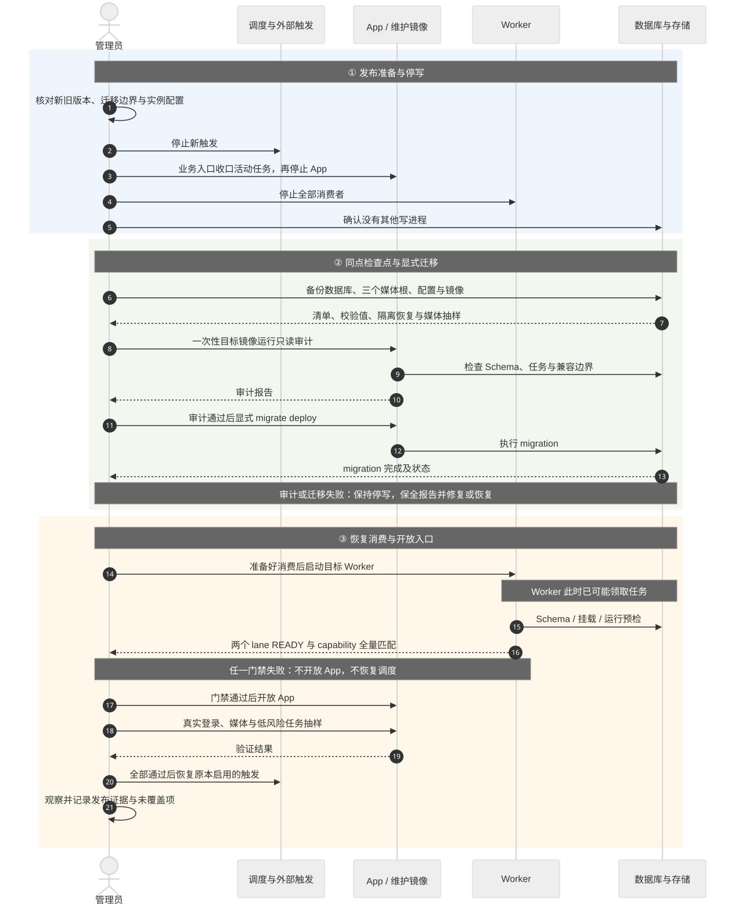

# 部署基线

本文是当前部署操作入口；`current` 表示已核对仓库配置，不表示某个生产实例已升级。首次跨越历史迁移边界时，先读[专项升级门禁](./runbooks/schema-and-capability-upgrades.md)，不能直接执行日常升级脚本。

## 当前拓扑与配置

支持单机 Docker Compose，生产使用预构建 App/Worker 镜像，本地开发使用宿主机 Next.js 加容器依赖。尚不承诺多副本 App、并行 Worker 或多租户部署。

| 服务        | 职责与权限                                                                                  | 默认端口         |
| ----------- | ------------------------------------------------------------------------------------------- | ---------------- |
| `app`       | Next.js 页面/API、认证和任务控制；数据库读写、原媒体默认只读、派生媒体读写、Pixiv data 只读 | 宿主机 5430      |
| `worker`    | 唯一后台消费者；数据库及三个媒体根读写；一个解析 lane 和一个写入 lane，各自串行             | 3011，仅容器网络 |
| `postgres`  | 领域数据、认证、队列、租约、migration 历史                                                  | 宿主机 5432      |
| `imgproxy`  | 只读原媒体/派生媒体并生成图片响应；当前 URL 未签名                                          | 宿主机 5431      |
| `scheduler` | 使用独立 Token 调用 App tick；不直接访问数据库                                              | 无宿主机端口     |

生产 Compose 包含 scheduler；实际实例是否启用应以 `config --services` 和 `ps` 为准。本地开发通过 `scheduled` profile 启用它。


[图源](../diagrams/operations/deployment-trust-boundaries.mmd)。图按当前 Compose 挂载与端口绘制；ImgProxy 是独立访问边界，不经过 App 会话校验。签名、认证与反向代理要求见[权限边界](../security/access-control.md)。

<a id="环境文件边界"></a>

| 配置来源                        | 用途                                          |
| ------------------------------- | --------------------------------------------- |
| `packages/pixishelf/.env.local` | 宿主机 Next.js；数据库通常为 `127.0.0.1:5432` |
| `build/.env`                    | Compose；容器数据库地址覆盖为 `postgres:5432` |
| `build/.env.example`            | 变量、默认值和路径模板；不是生产秘密备份      |

发布前核对数据库凭据、三个持久化媒体挂载、Better Auth URL/Secret/Trusted Origins、两枚独立服务 Token、HTTPS 和可信反向代理。`INIT_ADMIN_*` 与 `JWT_SECRET` 不负责当前账户初始化或浏览器会话。首次账户通过 `/login` 创建。

`ARCHIVE_HTTPS_PROXY` 的出站范围与优先级见[网络边界](../security/access-control.md#服务网络和存储矩阵)。Compose 环境变更须重建对应容器；本地 App 环境变更须重启本地进程。归档媒体并发保存于数据库 Setting，不增加环境变量。扫描和探测参数以模板及对应功能规格为准。

反向代理须允许 `/api/jobs/events` 长连接、禁用响应缓冲/转换并放行心跳。开发启动只遵循根 [README](../../README.md#本地开发)，不要从仓库根运行 `pnpm dev`。

## 标准发布

**Worker 启动即可能消费任务。旧 Dispatcher 开关已删除，不能创建“在线但不消费”的窗口。** App entrypoint 可自动 deploy migration，已有库遇破坏性升级则会由专用检查阻断；显式迁移流程能将数据库变化与开放 Web 入口分开。



[图源](../diagrams/operations/standard-release.mmd)。管理员负责停写与备份，目标 App 镜像负责迁移，Worker 负责预检/消费；任一步失败都保持调度停止。

1. 记录旧/新 App、Worker 的不可变镜像 ID/digest、实际配置和 migration 状态。阅读目标版本迁移与[专项门禁](./runbooks/schema-and-capability-upgrades.md)。
2. 停止 scheduler 和外部触发，等待活动任务完成或通过业务入口取消收口，再停止 App/Worker。核对无其他写进程或旧消费者。
3. 按[备份恢复基线](./backup-and-recovery.md)建立数据库、原媒体、派生媒体、Pixiv data、配置及版本的同点恢复集合，并验证可恢复。
4. 运行目标版本需要的只读审计，使用目标 App 镜像显式 deploy migration；禁止 `db:push`、盲目标记 migration 完成或手工删列。
5. 准备好恢复消费后启动 Worker，验证 READY 与 capability；再开放 App，完成登录/媒体/任务抽样，最后恢复原本启用的 scheduler 与外部触发。

以下模板从仓库根运行。实际 NAS 若使用别的 Compose 文件，必须先替换并核对路径；不要将其他实例的目录直接照抄。

```bash
docker compose --env-file build/.env -f build/docker-compose.deploy.yml ps -a
docker compose --env-file build/.env -f build/docker-compose.deploy.yml stop scheduler
docker compose --env-file build/.env -f build/docker-compose.deploy.yml stop app worker
```

完成停写、专项审计和一致性备份后：

```bash
docker compose --env-file build/.env -f build/docker-compose.deploy.yml pull app worker
docker compose --env-file build/.env -f build/docker-compose.deploy.yml up -d postgres imgproxy
docker compose --env-file build/.env -f build/docker-compose.deploy.yml run --rm --no-deps \
  --entrypoint prisma app migrate deploy --schema=packages/pixishelf-db/prisma/schema.prisma
docker compose --env-file build/.env -f build/docker-compose.deploy.yml up -d worker
docker compose --env-file build/.env -f build/docker-compose.deploy.yml exec -T worker node dist/healthcheck.cjs --mode=ready
docker compose --env-file build/.env -f build/docker-compose.deploy.yml exec -T worker node dist/capability-audit.cjs
docker compose --env-file build/.env -f build/docker-compose.deploy.yml logs --tail=200 worker
docker compose --env-file build/.env -f build/docker-compose.deploy.yml up -d app
```

capability 必须与目标镜像的 [`production-capabilities.ts`](../../packages/pixishelf-worker/src/production-capabilities.ts) 中完整 type/version/lane inventory 一致。不要用固定任务数量或 `/livez` 代替 READY/capability 门禁。新 App 入口只能在配套 Worker 能力就绪后开放。

已完成所有专项升级的日常版本可以使用：

```bash
sudo bash ./scripts/update-production.sh \
  --compose-file build/docker-compose.deploy.yml --env-file build/.env
```

脚本成对更新 App/Worker，并恢复原本运行的 scheduler；默认拉取镜像。`--no-pull` 使用已有镜像；`--force` 仅允许中断执行中任务，不豁免审计和备份。`PIXISHELF_PRE_UPDATE_HOOK` 是停写后的可执行检查点脚本；未配置时更新脚本只警告，**不会自动创建备份**。脚本先启动 App，由 entrypoint 迁移，再启动 Worker，因此首次跨越专用迁移边界应使用上方显式流程。

## 运行验证与观察

- 开放调度前：实际 HTTPS 登录和 Cookie、画廊查询、原图/视频、派生封面与缺失占位、一个低风险任务、控制操作、两个 lane READY 和 capability 全量匹配。
- 归档变更：连续收件不阻塞、刷新后状态保留、解析与写入可并行、同 lane 无重叠、旧等待任务可继续；具体验收见[归档收件箱](../features/archive-intake.md)。
- 24–72 小时：异常日志、任务积压/重试、租约、媒体 404、磁盘增长和日志轮转。
- 至少覆盖一次上海时区夜间计划窗口；涉及迁移/退役时按专用手册完成更长观察期，记录真实任务和自动 GC。

全部通过后再恢复原本启用的 scheduler。每次发布记录日期、环境、源码版本、镜像 digest、备份集合、审计/验证结果和未覆盖项；记录放在[运维记录](../records/operations/)，不要把测试数字追加到本基线。

## 故障分流与回退

| 症状                          | 首先检查                                               | 处置入口                                                |
| ----------------------------- | ------------------------------------------------------ | ------------------------------------------------------- |
| migration 或 READY 失败       | migration 历史、挂载权限、FFmpeg/FFprobe、目标版本能力 | 保持 App/调度关闭，修复预检；不绕过门禁                 |
| 重复 claim、租约/状态异常     | 其他消费者、任务/领域状态与日志                        | 停 scheduler、App/Worker 及外部写入，保存现场           |
| 登录、来源或媒体失败          | 可信代理、Cookie、Token、路径、网络/远端限制           | [权限边界](../security/access-control.md)、对应功能规格 |
| 文件或领域状态不一致          | manifest、报告、原件与检查点                           | [领域恢复](./runbooks/domain-recovery.md)               |
| 数据库/原媒体损坏或不兼容降级 | 完整恢复集合及检查点后损失                             | [完整恢复](./backup-and-recovery.md#灾难恢复顺序)       |

服务级回退只允许使用兼容现有 Schema、payload 与 lane 的配套 App/Worker。**双 lane 迁移、旧身份字段删列或后台任务二阶段删列后，不能仅换旧镜像。** 无法证明兼容时优先前向修复；必须降级则在隔离验证后恢复同点集合。不要删除卷、盲清锁或在执行中任务存在时强制回滚 Schema。

构建资产见 [build](../../build/README.md)，发布流水线见 [GitHub 工作流](../../.github/README.md)，历史切换结果见[后台任务切换记录](../records/operations/background-task-cutover-deployment.md)与[收件箱切换记录](../records/operations/archive-intake-cutover-deployment.md)。
