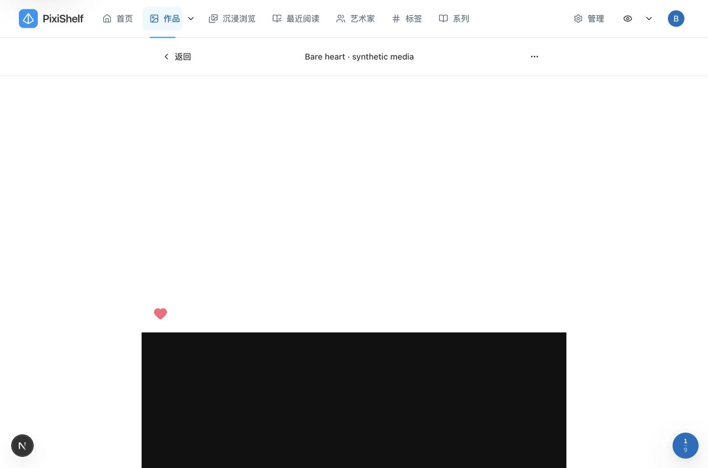
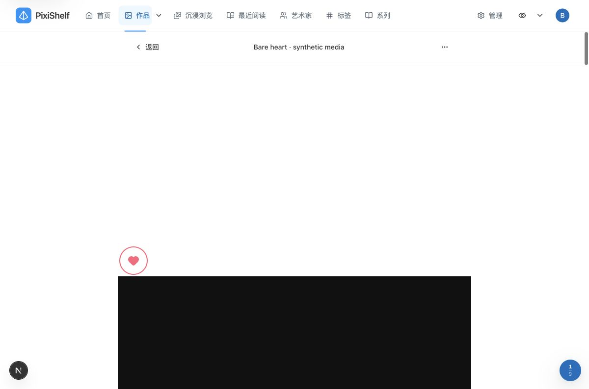
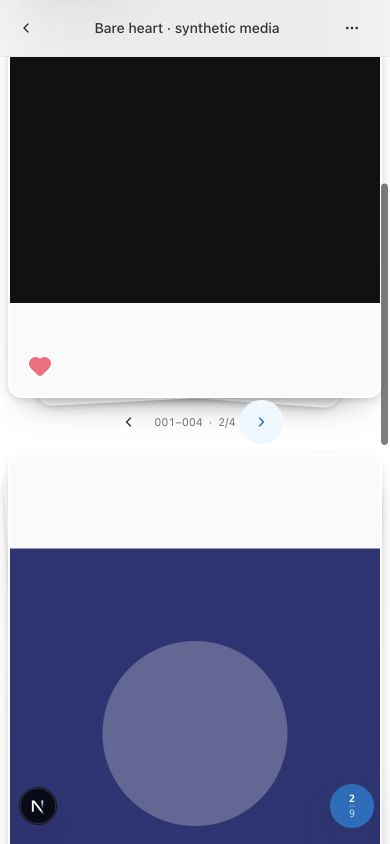
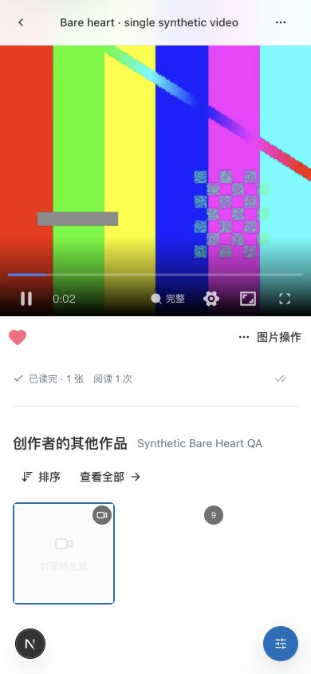
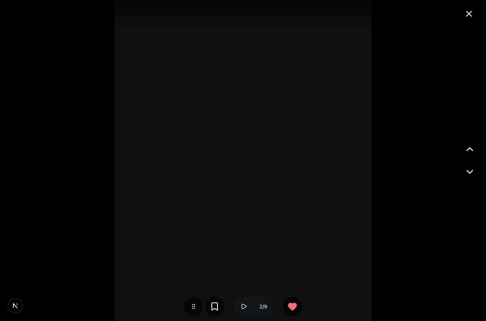

# 详情裸爱心验证

适用版本为 `6007ba70` 基线上的本地改动。当前行为见[单图标记](../../features/media-marks.md)。本次只验证详情已喜欢按钮去掉底圈，未提交、推送或部署，不代表生产或手机真机验收。

## 环境与范围

macOS、Chrome，桌面视口 1200×794，窄视口 390×844；后者为真实浏览器视口覆盖，不是手机真机或触摸验证。所有入口使用 `entry=direct`。独立应用副本使用单独 `.next` 与 5440 端口，专用 `bare-like.localhost` 隔离站点会话与偏好；PostgreSQL 15 临时库位于 `55435/preview_dock_fixture`，从空库部署完整 134 条现有 migrations，未用 `db:push`。ImgProxy 55436 只读挂载合成媒体。

样本为一个合成账户、一位艺术家、两件作品、十项媒体：纯白与近黑图片、六张既有合成图、混合列表视频和独立视频。未读取或修改真实收藏、业务数据库或其他服务。

## 浏览器结果

- 完整列表未喜欢时隐藏爱心，双击画面显示粉色实心裸心及既有浮心；取消后隐藏。纯白与近黑背景上普通、悬停及鼠标按住状态均透明，无边框或阴影；按住时实际检查 `:active=true`。
- 详情按钮实测桌面 48×48px、窄视口 44×44px，心形均为 24×24px，填充与颜色为既有 `--media-like-color`，`aria-label` 与 `aria-pressed=true` 保留。键盘聚焦时粉色 2px outline 在纯白与近黑图上可见，普通和悬停无辅助轮廓。
- 堆叠桌面和窄视口均显示裸心；窄视口从已喜欢媒体 2 翻到未喜欢媒体 3 时隐藏，返回媒体 2 后恢复，取消后隐藏，当前媒体身份正确。
- 视频下方行未喜欢时隐藏，原“图片操作”菜单添加喜欢后左侧显示裸心，右侧菜单及播放器保留，取消后隐藏；桌面与窄视口触控盒分别为 48px 与 44px。下方仅用完整入镜的窄视口截图作为视频行视觉证据。
- 全屏适配预览仍使用默认 `button` 外观，实测爱心底色为 `rgba(0, 0, 0, 0.65)`，与详情共享选中状态。菜单保留原书签和喜欢入口。

禁用状态的外观由同一 bare 选择器覆盖；没有为了制造该短暂状态修改页面 DOM、媒体写入状态或标记逻辑。暂停自动浏览、共享状态、双击已喜欢不重复保存、取消不飘心等行为由既有相关回归覆盖。浏览器未发现控制台错误；保留既有 Next.js 图片 quality=90 未配置的开发警告，不在本次样式范围修复。











## 工程检查

聚焦命令在 `packages/pixishelf` 执行：

```bash
pnpm exec vitest run components/media-mark/__tests__/media-mark-actions.test.tsx 'app/artworks/[id]/_components/__tests__/detail-media-interaction.test.tsx' 'app/artworks/[id]/_components/__tests__/adaptive-media-preview.test.tsx' --maxWorkers=2
```

三文件 34 项通过：7 项标记操作、7 项详情交互、20 项适配预览。复用现有回归，未增加只重复样式实现的测试。四个变更 UI 源文件的 Impeccable manual detect 返回 `[]`；lint 为 0 warnings、0 errors。

`pnpm typecheck`（Next typegen 与 TypeScript，含测试）通过；提升权限的 `pnpm run test --maxWorkers=2` 一次完成，479 文件通过、49 跳过，3568 tests 通过、351 跳过，总计 528 文件／3919 tests，耗时 214.30s。`pnpm test` 的既有配置排除 integration、jsdom e2e 与扫描 fixture；跳过主要为未配置专用 PostgreSQL URL 的已有数据库套件，没有将这些未运行范围计为通过。

提升权限的 `pnpm build` 通过，Turbopack 编译 12.3s，TypeScript、页面数据收集及生成成功。`pnpm docs:check` 检查 359 Markdown 通过，`WEBP_BROWSER_CHANNEL=chrome pnpm docs:diagrams:check` 检查 34 图源及 23 个内嵌 Mermaid 通过；未下载浏览器。`rg --files packages/pixishelf | rg '[A-Z]'` 无命中，`git diff --check` 通过。

## 清理与证据

本次浏览器 tab 已关闭，临时 viewport 已 reset；独立应用 PID 79151 和两个 `pixishelf-bare-like-20261031-*` 临时容器已停止。5440、55435、55436 无监听；原 5430 仍由既有 PID 79743 监听。仅保留合成 fixture 与本地证据。

本地材料位于 `.local-data/bare-like-20261031/`，其中 `seed.ts`、`fixture.json`、`cleanup.json` 与 `review/` 保存隔离种子、身份、清理核对和原始截图；既有合成媒体及应用副本复用 `.local-data/preview-dock-20261031/`。原始输出位于 `/private/tmp/bare-like-migrations.log`、`bare-like-dev.log`、`bare-like-typecheck.log`、`bare-like-unit-test.log`、`bare-like-build.log`、`bare-like-docs-check.log`、`bare-like-diagrams-check.log`、`bare-like-impeccable-detect.json`。
