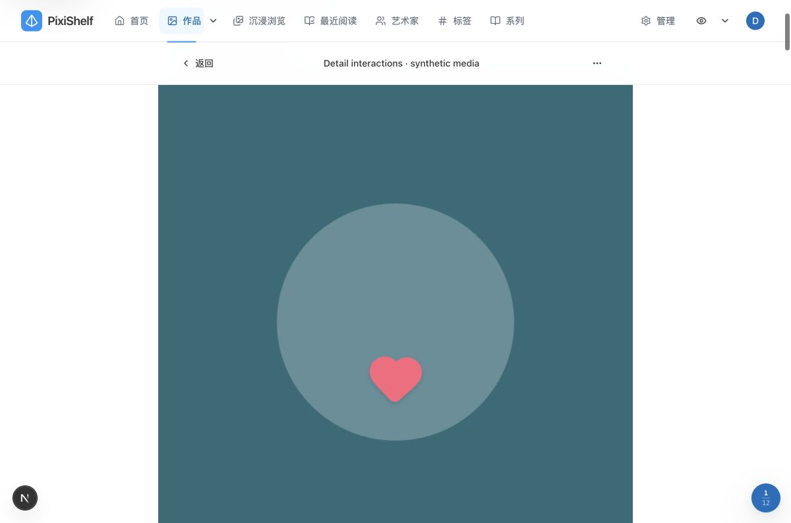
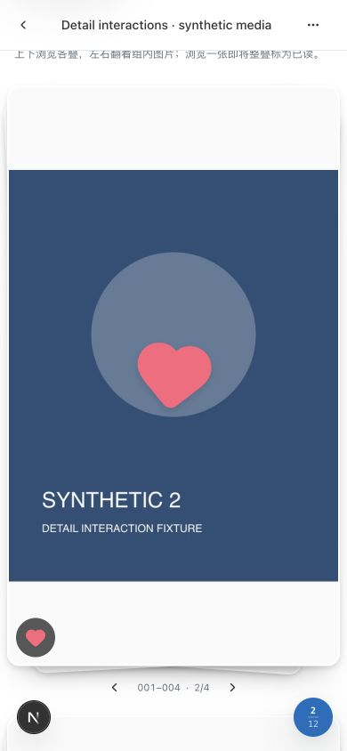
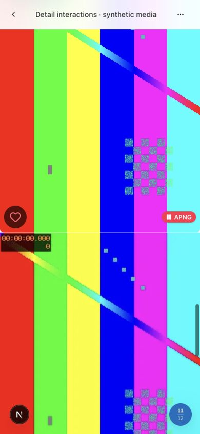

# 详情媒体交互验证 · 2026-10-30

适用版本：本地 `190187bf` 基线上的未提交工作区改动，不表示生产已部署。当前行为由[单图标记](../../features/media-marks.md)、[堆叠浏览](../../features/artwork-summary.md)及[自动浏览](../../features/artwork-auto-browse.md)维护。

## 环境与恢复依据

macOS、Node 20.19.4、pnpm、Chrome。独立副本运行在 `127.0.0.1:5440`，临时 PostgreSQL 15 使用 `55435/detail_likes_fixture`，独立 ImgProxy 使用 `55436`、只读挂载合成媒体。空库执行全部 134 条已有 migrations，未使用 db:push。样本为一个测试账户、一个作品、8 张合成 PNG、各一份合成 GIF/APNG/WebP 与无声 MP4；各动画使用不同文件名，避免被原有逻辑媒体组合机制合并。

业务数据库、原媒体和既有 `5430` 应用／`5431` 图片服务未修改或停止。本次不需要业务备份恢复：所有写入只发生于强校验端口和库名的空白 fixture。验收后已关闭临时浏览器标签并恢复视口，停止本任务独立应用、移除两个 `--rm` 临时容器。`5440/55435/55436` 已无监听；既有 `5430` 仍由原 PID 79743 监听。合成截图、种子与清理证据保留在 `.local-data/detail-likes-20261030`，工程原始日志位于其中的 `checks/unit-final.log` 和 `checks/build.log`。

fixture 准备曾遇到复制应用的相对 workspace 别名、ImgProxy 默认监听端口、空库缺少 scanPath 设置的问题，均在隔离环境内修正后继续；不作为应用功能失败或通过的证据。

## 浏览器批次

桌面实际视口为 1200×794，响应式视口为 390×844。后者不是手机真机，不证明真实触摸屏或 iOS/Safari 行为；触摸、多指及兼容鼠标事件由组件事件组合回归覆盖。本次完成一次桌面与响应式功能／截图批次，菜单触控高度修正后仅做一次确认。

| 操作                       | 实际结果                                                                                                                                        |
| -------------------------- | ----------------------------------------------------------------------------------------------------------------------------------------------- |
| 静态图单击、双击与再次双击 | 单击不打开预览；双击填充当前单图爱心并在落点出现粉色实心反馈；已喜欢再双击保持状态并再次反馈                                                    |
| Enter 菜单、全屏阅读与关闭 | 打开原图片菜单；“进入全屏阅读”仍是既有适配预览；预览与详情共享喜欢状态；预览切到第 2 张后关闭回第 2 张                                          |
| GIF 与 APNG                | 画面单击不播放；右下角独立按钮播放；APNG 实际 canvas 为 400×500、可见且 aria-pressed=true，暂停仍可用                                           |
| WebP 与视频                | WebP 原流式 canvas 状态 ready；视频正常加载 2 秒合成片段并自动播放，原播放器手势区域与菜单保留，视频爱心位于下方操作行                          |
| 堆叠当前身份               | 第 2 张单击保持未喜欢；双击后仅当前第 2 张爱心选中，首张状态独立；组内下一张与方向键由原流程负责                                                |
| 长按与键盘暂停             | 移动布局下 550ms 长按打开同一菜单；启动自动翻阅后，焦点内 Space 激活爱心令控件显示“继续”，保存不会恢复翻阅                                      |
| 控件布局                   | 移动 APNG 与爱心均至少 44px、分别位于左右下角；桌面爱心 48px；两个阅读菜单按钮实测均 44px；无嵌套 button；表面 touch-action 为 pan-y pinch-zoom |

浏览器开发日志记录过 hydration mismatch（其中一条明确涉及扩展添加的 `data-immersive-translate-page-theme`），以及原有 Image quality=90／LCP 提示；本记录不声明控制台零警告。没有为消除这些提示修改其他产品流程。

## 自动化与工程验证

聚焦回归覆盖双击 300ms／40px 边界、移动 10px、长按、多指／取消、鼠标兼容事件去重、内部控件排除、切媒体和卸载清理；真实标记 session 覆盖已喜欢零重复保存、乐观更新失败回退 toast、账户隔离、虚拟重挂载以及跨入口状态共享。浮动心覆盖叠加、800ms 清理、切媒体／卸载清理和 reduced motion 静态反馈。堆叠使用真实 pointer+touch+兼容 mouse 事件组合验证当前媒体身份及取消待配对短按；保留原阅读、播放器与预览回定位回归。

执行结果：

| 命令／范围                                                        | 结果                                                                                                                                                                  |
| ----------------------------------------------------------------- | --------------------------------------------------------------------------------------------------------------------------------------------------------------------- |
| 主应用 `pnpm lint`                                                | 0 warnings、0 errors                                                                                                                                                  |
| 主应用 `pnpm typecheck`                                           | `next typegen && tsc --noEmit` 通过，包含测试文件类型                                                                                                                 |
| 主应用提升权限 `pnpm test`                                        | 478 文件通过、49 文件跳过；3537 tests 通过、351 tests 跳过。跳过项主要为未设置专用 PostgreSQL 测试 URL 的已有数据库套件；本次空库迁移与浏览器 fixture 另行验证        |
| 最后手势／当前媒体回归 `vitest run`                               | `detail-media-interaction`、`use-detail-media-gestures`、`artwork-stack-card` 三文件共 39 tests 通过；在全量之后补上播放器阻止冒泡与兄弟爱心中断旧 tap 配对的两项回归 |
| 提升权限 `pnpm build`                                             | 通过；编译 19.3s，46/46 静态页面生成。使用明确的隔离数据库、合成媒体与认证环境，未连接业务库。最后兄弟爱心 cancel 回调收尾另由上述聚焦回归与类型检查核验              |
| `pnpm docs:check`                                                 | 351 Markdown 本地链接、锚点、路径大小写和围栏通过                                                                                                                     |
| `WEBP_BROWSER_CHANNEL=chrome pnpm docs:diagrams:check`            | 34 图源与 23 内嵌 Mermaid 通过；默认无浏览器 channel 的首次命令因缺少 Playwright headless shell 失败，按现有脚本使用本机 Chrome 后通过，未下载浏览器                  |
| `rg --files packages/pixishelf \| rg '[A-Z]'`、`git diff --check` | 主应用无大写路径；diff 空白检查通过                                                                                                                                   |
| Impeccable detector                                               | 对本次 5 个主要 UI 文件仅运行一次，结果 `[]`；截图仍单独批量检查                                                                                                      |

首次受限环境全量中，5 项因禁止回环端口／tsx IPC 监听失败；3 项视频阅读布局测试因新增标记控件需要 Provider 失败。后者已在专注阅读计账的测试中隔离标记 UI，真实标记行为仍由独立组件回归验证，没有删断言或放宽领域规则；提升权限全量随后通过。`pnpm test` 按项目既有配置排除 integration、jsdom e2e 与扫描 fixture integration，本次未声明这些未运行套件通过。

未覆盖：手机真机、多浏览器触摸行为、NAS/NFS 与弱网性能、生产部署及真实私人媒体。没有新增 API、数据库字段、依赖或部署配置；未提交、打标签、推送或部署。
