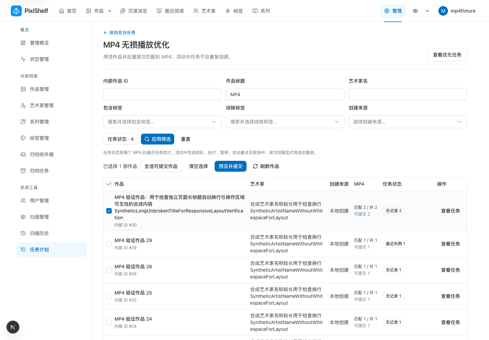

# MP4 独立页面与查询提速验证 · 2026-11-06

适用版本：基线 `29f58bb4f168b5ee0fe0de23d0ad31045c22076d` 上的本地未提交改动。日期使用 America/Los_Angeles。当前规则见[MP4 无损播放优化](../../features/mp4-streaming-optimization.md)，原媒体处理闭环见[先前验证](./mp4-streaming-optimization-2026-10-31.md)。本记录不表示生产已部署；本次没有生产写入、迁移或任务提交。

## 诊断与性能

经用户指定的生产连接，只读、10 秒语句上限核查执行计划。媒体表估计 1,855,523 行，有效 MP4 1,601 条。旧首页为返回 20 部作品过滤约 678,948 条非 MP4；总数另做全表扫描。两条 SQL 单次分别为 1,861.068ms、1,617.860ms。原应用并行执行，不能相加，也不是浏览器完整等待时间。现有两条任务历史表达式索引正常命中。

隔离 PostgreSQL 15.14 使用 21,604 部作品、1,855,523 条媒体、1,601 个 MP4、31,225 条任务记录；MP4 分布在较早作品中，模拟大量较新非 MP4 的扫描开销。默认匹配 1,561 部作品。合成数据、SQL、参数、样本及代表性执行计划见[脱敏证据](../evidence/mp4-optimization-workbench-2026-11-06.json)。

| 同一合成库，默认第一页           | 旧两条 SQL 并行 | 新单条 SQL |
| -------------------------------- | --------------: | ---------: |
| Prisma EXPLAIN 调用 p50          |      1,520.83ms |    16.46ms |
| Prisma EXPLAIN 调用 p95          |      1,952.48ms |    19.58ms |
| 服务器 SQL p95（旧取两条较大值） |      1,933.98ms |    14.44ms |

每组先预热一次，再执行 20 次，以 nearest-rank 计算 p95。旧 SQL 为基线等值常量复刻，新 SQL 从当前服务的参数化查询捕获。比较真实结果时，有序作品列表深比较、精确总数均相同。新计划使用 `Image_mp4_artwork_id_idx` 的 Index Only Scan，只读 1,601 条 MP4；代表样本该节点 shared hit 8、read 0。旧首页仍过滤约 68.9 万条非 MP4，总数以三个参与进程扫描媒体表。

默认查询满足 p95 ≤ 500ms、下降至少 80% 的隔离验收目标。此结果只证明该数据分布下默认第一页的数据库改善，不是生产、HTTP、所有筛选或预览接口的 p95；预热也不代表全部数据均在内存缓存中。

## 迁移与环境

独立 PostgreSQL 容器只映射回环端口 57432。空库完整应用 141 条正式 migration；非空性能库先应用 HEAD 的旧迁移链并写入合成数据，再通过 `db:deploy` 增量升级。新增索引迁移耗时约 1.26 秒，索引有效，migration 状态正常。没有使用 `db:push`。

首次大数据写入遇到 Docker 虚拟磁盘空间不足；仅移除本任务失败容器及匿名卷，再把测试数据放到宿主临时目录挂载，重新完成验证。未 prune 镜像、构建缓存或业务卷。生产索引创建仍须遵循现有停写发布流程，不能把本机创建时长作为生产维护窗口承诺；旧应用回退可保留这个附加索引。

浏览器 App 使用排除真实环境文件的独立源码快照，通过 Webpack dev 在专用 localhost 主机名与端口运行；数据库、认证账户、媒体目录均为本任务合成数据。没有启动测试 Worker，也没有连接生产媒体目录。

## 浏览器与独立审查

真实 Chrome 的 1440×1000、390×844 视口验收通过：

- 首次进入和编辑草稿仅保留管理 shell 的归档角标请求，没有候选、预览、提交、任务总览或历史请求。
- 应用、下一页、上一页、刷新、窄屏重新应用各发一次候选请求；跨页和关闭全局／单作品执行动态后保留选择。
- 单作品预览准确显示两个 MP4；全选可提交作品支持排除；重置回到未查询态且不额外请求。
- 旧 task 链接跳转独立页面，组合 jobId 时保留原任务详情。
- 390px 视口文档宽度仍为 390px；表格独立滚动容器宽 356px、内容宽 708px，横滚后可操作「查看任务」。

浏览器停在预览并取消，提交请求为零；真实入队、冻结目标、重试和并发复用由隔离 PostgreSQL 测试覆盖。另在 30 部作品、32 条媒体的小型浏览器 fixture 上，对已预热的鉴权 tRPC 请求重复 20 次，HTTP p50 24.62ms、p95 54.68ms；这是 Webpack dev 环境，不能与上面的百万媒体数据库基准混为一项指标。

[单作品执行动态](./assets/mp4-optimization-workbench-2026-11-06/history.png)、[固定目标预览](./assets/mp4-optimization-workbench-2026-11-06/preview.png)、[窄屏操作栏](./assets/mp4-optimization-workbench-2026-11-06/narrow.png)、[表格内横滚至行操作](./assets/mp4-optimization-workbench-2026-11-06/narrow-actions.png)。截图已禁用动画并等待目标状态，均仅含合成数据。

实施与独立审查分别由 GPT‑6.1 sol / xhigh agent 完成。审查者独立运行服务／鉴权、UI 与 PostgreSQL 回归，检查执行计划、基准方法及稳态截图，未发现阻塞项。

## 工程检查与限制

| 检查                                         | 结果                                                                                                                                  |
| -------------------------------------------- | ------------------------------------------------------------------------------------------------------------------------------------- |
| 主应用 lint、typecheck                       | 通过；lint 1,514 文件，零警告／错误                                                                                                   |
| 最终全量 `TZ=UTC pnpm test`（允许回环／IPC） | 514 文件、3,809 测试通过；54 文件、394 测试跳过                                                                                       |
| 四套显式 PostgreSQL 回归                     | 最终 16 个不同测试通过；含旧任务同时间戳按 ID 决胜、UNKNOWN/.Mp4、空页 total、ACTIVE-only、1,000／1,001、冻结目标、部分成功和并发复用 |
| 独立 UI／路由／导航回归                      | 8 文件、123 测试通过；另服务／鉴权 5 测试通过                                                                                         |
| 主应用提升权限 `pnpm build`                  | 通过，包含新增独立路由                                                                                                                |
| Prisma validate、空库／非空升级              | 通过                                                                                                                                  |
| 文档与图示检查、路径命名、diff 检查          | 通过；图示检查使用本机 Chrome                                                                                                         |
| impeccable 修改 UI 机械扫描                  | 零项                                                                                                                                  |

首次受限环境全量为 511 文件通过、3 文件失败，6 项失败分别是五项监听权限错误及一项既有日期时区断言。审查者在未修改 HEAD 的临时快照中复现 America/Los_Angeles 日期失败，同一快照 UTC 下 18 项通过；两套网络／CLI 测试提升权限后 35 项通过。未为消除这些失败改动任务外代码。最终全量明确使用 UTC 和回环／IPC 权限，不能表述为任意时区及沙箱环境均通过。

默认全量仍跳过未配置环境的 PostgreSQL 等套件，也不包含所有 integration／浏览器链路。本次未测生产新查询、NAS/NFS、手机真机或多浏览器；生产收益须部署 migration 与应用后再测。

验收后关闭专属浏览器与 App，移除本任务 PostgreSQL 容器、合成数据和源码快照，仅保留本记录、脱敏 JSON 与截图。既有业务容器、数据库和收藏未参与写入验证。
