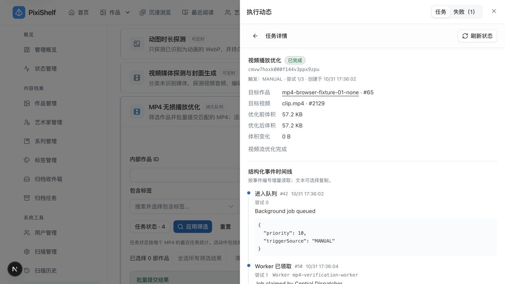

# MP4 无损播放优化验证 · 2026-10-31

适用版本：`8f2046a2cfc42704f24cf96ebd73557c03dbcf01` 基线上的本地未提交改动。当前规则见[MP4 无损播放优化](../../features/mp4-streaming-optimization.md)、[执行动态](../../features/background-job-history.md)与[媒体处理](../../architecture/media-processing.md#视频流优化)。本记录不表示生产已部署或全部测试通过。

## 环境、样本与恢复依据

macOS、Node 20.19.4、pnpm 8.15.9、PostgreSQL 15、FFmpeg／FFprobe、真实 Chromium 浏览器。独享容器 `pixishelf-mp4-verification-postgres` 仅映射 `127.0.0.1:57432`，空库 `mp4_optimization_verification` 通过 `pnpm --filter @pixishelf/db db:deploy` 应用全部 134 条已有迁移，`db:status` 确认 up to date，未使用 db:push。

App 在独立源码快照运行，地址 `http://mp4-fixture.localhost:57430`；独立 Worker 健康端口 `57411`，配置只连接上述库与本任务临时媒体。专属主机名避免影响既有实例的 Cookie。浏览入口带 `entry=direct`，不绕过登录；测试账户和媒体均为合成数据。

浏览器种子含 28 部作品、29 个 MP4、一个用于核对排除规则的非 MP4 媒体，以及失败、取消、跳过、成功、暂停的历史任务。一个作品含两个 MP4。样本为 1 秒、320×180、H.264＋AAC 合成片段；精确字节数、SHA-256、任务／媒体 ID 与数据包核对见[脱敏证据](../evidence/mp4-streaming-optimization-2026-10-31.json)。不使用既有收藏或业务库做写入验证，因此无需从业务备份恢复。

初次快照启动遇到 Turbopack 拒绝跨根 node_modules 符号链接，独立浏览器 App 改用 `next dev --webpack --port 57430`；Worker 按现有构建脚本生成 CJS 后启动。主工作区 production build 仍使用原 `pnpm build`／Turbopack。种子准备中补齐了既有 SKIPPED 约束所需的跳过原因与时间，未修改产品约束。

## 真实浏览器与视频闭环

桌面视口 1280×720；另做一次 390×844 响应式抽样，documentWidth 与 viewport 均为 390，表格横向滚动限制在组件内。该抽样不是手机真机验收。

| 场景                     | 实际结果                                                                                                                                               |
| ------------------------ | ------------------------------------------------------------------------------------------------------------------------------------------------------ |
| 默认候选与状态           | 默认只显示无记录、失败、取消、跳过；历史成功与暂停目标不进入默认结果；20 项第一页、6 项第二页，按作品 ID 倒序                                          |
| 跨页与全筛选选择         | 第一页勾选后到第二页保留；全选所有筛选结果后排除一部作品，界面显示排除数；应用新标题筛选清空选择                                                       |
| 多媒体作品预览           | 作品 #65 仅预览两个 MP4，不包含同作品的非 MP4；确认显示一部作品、两个 MP4、零成功重做                                                                  |
| 提交到真实执行           | 浏览器提交返回新建 2；持久任务由本任务 Worker 执行，两个均为 `COMPLETED`；执行动态与原 `jobId` 深链都可打开详情                                        |
| 详情与结果               | 完成详情显示作品名／#65、视频名／ID、57.2 KB → 57.2 KB、0 B；带合成结果的 FAILED 详情不显示完成体积                                                    |
| 单作品历史范围           | 从作品 #88 进入仅一条优化历史；切换为图库扫描后仍显示作品 #88 标记、零匹配，没有扩展到全库                                                             |
| 预览后路径变化与部分成功 | 预览失败目标 #88 和普通目标 #87 后，仅在 fixture 移动 #88 的登记路径；提交返回新建 1、跳过 1，逐项展示“历史任务的视频已失效或路径发生变化，请重新预览” |
| 重试跳过零副作用         | 上述旧 FAILED 保留原状态、无 RETRY 子任务、无失败确认；另一个目标独立完成                                                                              |
| 查询错误与恢复           | 短停专属 PG 后刷新，显示受控加载失败、保留已有行及一部作品选择；恢复 PG 并点击重新加载后错误消失，选择仍保留                                           |

三个真实完成任务均为 58,621 → 58,621 bytes。逐流 FFprobe 核对 H.264 的 12 个 packet、AAC 的 45 个 packet：每个数据包的 SHA-256 序列与源样本完全一致，编码、宽高、采样率、声道与时长等所选流信息一致。源文件顶层 `moov` 在 `mdat` 后，结果在其前，确认 faststart；不以体积缩小作为成功条件。Worker 也执行了原有 remux 校验与事务发布。

[单作品类型交集为空](./assets/mp4-streaming-optimization-2026-10-31/artwork-scope-empty.jpg)、[390px 抽样](./assets/mp4-streaming-optimization-2026-10-31/mobile.jpg)、[查询错误仍保留选择](./assets/mp4-streaming-optimization-2026-10-31/query-error.jpg)。截图仅包含合成作品。

查询故障注入产生预期的 tRPC／表格控制台错误；Worker 在数据库连续不可达后按现有门禁退出，当时没有运行中的任务。本次不声明控制台零警告，也不把故障注入作为 Worker 自动恢复能力的验收。

## 自动化与工程检查

所有主应用命令在 `packages/pixishelf` 执行，使用受控环境注入本任务隔离数据库／媒体配置；不回显连接凭据。build 与需要回环监听的测试提升权限。

| 命令／范围                                             | 结果                                                                                                                            |
| ------------------------------------------------------ | ------------------------------------------------------------------------------------------------------------------------------- |
| `pnpm lint`                                            | 1,448 files，0 warnings、0 errors                                                                                               |
| `pnpm typecheck`                                       | `next typegen && tsc --noEmit` 通过，含测试文件类型                                                                             |
| 首次 `pnpm test`                                       | 482 files 通过、3 files 失败、51 files 跳过；3,584 tests 通过、6 tests 失败、367 tests 跳过                                     |
| 最终原命令 `pnpm test`                                 | 484 files 通过、1 file 失败、51 files 跳过；3,594 tests 通过、5 tests 失败、367 tests 跳过，122.74s；仅下述已证明的基线去重失败 |
| `pnpm build`                                           | 通过，Turbopack 编译 25.3s，类型检查及 production 路由构建完成                                                                  |
| 四套显式 PostgreSQL 回归                               | 4 files、15 tests 通过；测试变量为 `PIXISHELF_TEST_DATABASE_URL`，只指向本任务空库                                              |
| `pnpm docs:check`                                      | 366 Markdown 的本地链接、锚点、路径大小写和围栏通过                                                                             |
| `WEBP_BROWSER_CHANNEL=chrome pnpm docs:diagrams:check` | 34 图源、23 内嵌 Mermaid 通过；未改图源或生成 SVG                                                                               |
| `rg --files packages/pixishelf \| rg '[A-Z]'`          | 无输出，主应用无大写路径                                                                                                        |
| `git diff --check`                                     | 通过                                                                                                                            |

显式 PG 命令为 `pnpm exec vitest run services/__tests__/video-optimization-batch.postgres.test.ts services/background-task/__tests__/media-job-query.postgres.test.ts services/background-task/__tests__/job-history-service.postgres.test.ts services/background-task/__tests__/job-command-postgres-integration.test.ts`。覆盖状态先筛选再分页、旧任务 JSON 目标、1,000／1,001 上限、固定目标不扩张、状态及路径变化、部分成功、retry 链与失败确认、任务详情和单作品历史，以及普通入队／批量／retry 对同一视频的竞争。

竞争用例曾真实复现 PostgreSQL `40P01`：通用 retry 先锁旧 job 恢复记录再取视频 advisory lock，批量相反。修复为 MP4 入口先取相同 image advisory lock，再执行既有恢复门禁；三入口并发返回同一活动 job ID，数据库只留一个 PENDING，恢复阻断仍拒绝且零新建／零确认。非 MP4 的既有锁顺序不变。

首次全量另外暴露 `video-keyframe-service.test.ts` 的 `node:fs/promises` mock 缺少 default 导出，保留原真实导出及所需 mock 后，原 9 项断言和相关 central／command 共 67 项聚焦通过。`archive-uploader-sources.test.tsx` 的 101 项选择用例在首次全量超时 5 秒；两次独立聚焦均为 47／47，通过用例耗时约 998ms／935ms，没有改 timeout 或断言。

五项去重失败由原始 HEAD 基线单独证明：`git archive HEAD` 到临时目录，只读复用依赖，在基线执行 `pnpm exec vitest run services/__tests__/artwork-dedup-display.test.ts` 同样 5／5 失败。该套仍期待已退役的 CANCEL／STOP／DIRECT_DELETE／ALLOW_REIMPORT，而当前实现返回空动作；本任务未放开退役能力，也未修改该套断言。基线和最终全量结果分开保留，不用聚焦通过替代全量通过。

`pnpm test` 仍按项目脚本排除 integration、jsdom e2e 和扫描 fixture integration；未配置专用数据库变量的既有 PG 套件跳过。上述显式 15 项 PG 不代表所有数据库测试已执行。没有改认证 transport、Worker 算法、Schema、迁移、依赖、锁文件或部署配置；未做生产部署、NAS／NFS、私人媒体、多浏览器或手机真机验证。

## 清理

已关闭临时浏览器标签、还原视口并停止独立 App／Worker；专属 PostgreSQL 容器及准确关联的匿名数据卷已删除，临时源码快照、原始日志、凭据、种子与合成媒体已清理。57430／57411／57432 均无监听；既有 5430 仍由原 PID 79743 监听，业务数据库容器 pixishelf-db 仍在 5432 运行。本任务没有停止或改写既有业务服务与收藏。稳定证据只保留本页、脱敏 JSON 和上述四张合成截图；不提交凭据、数据库 dump、完整日志、源码快照或 fixture 原媒体。
