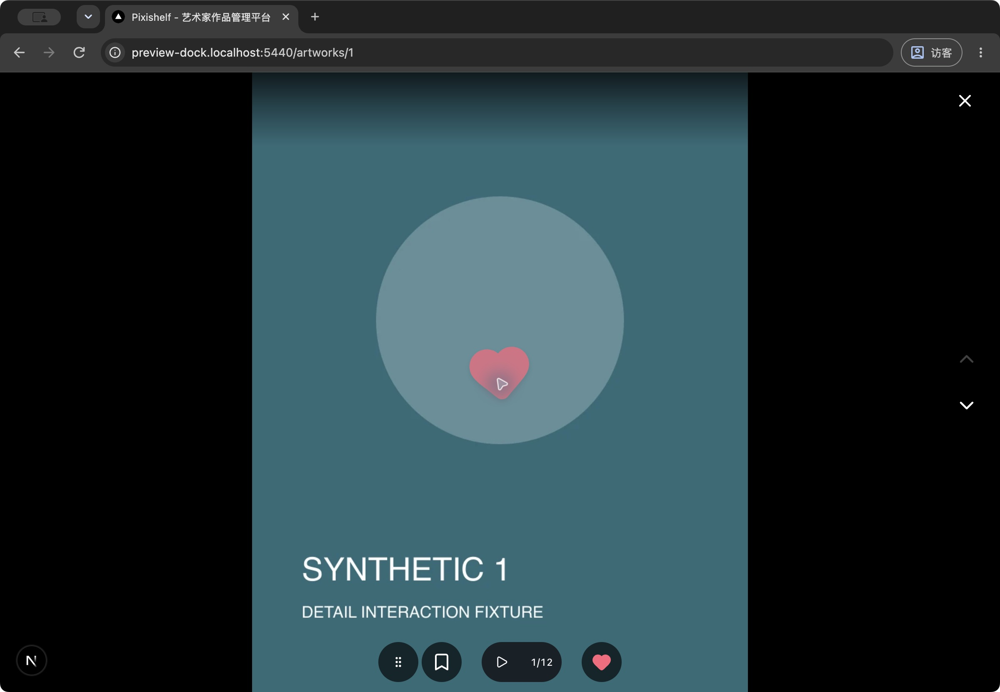
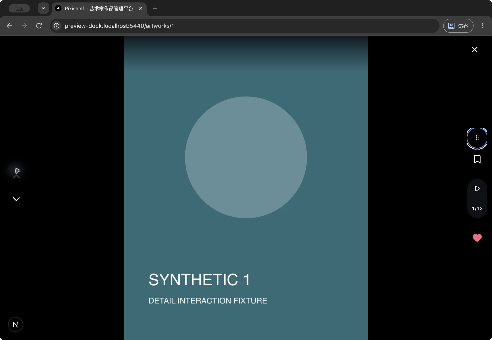
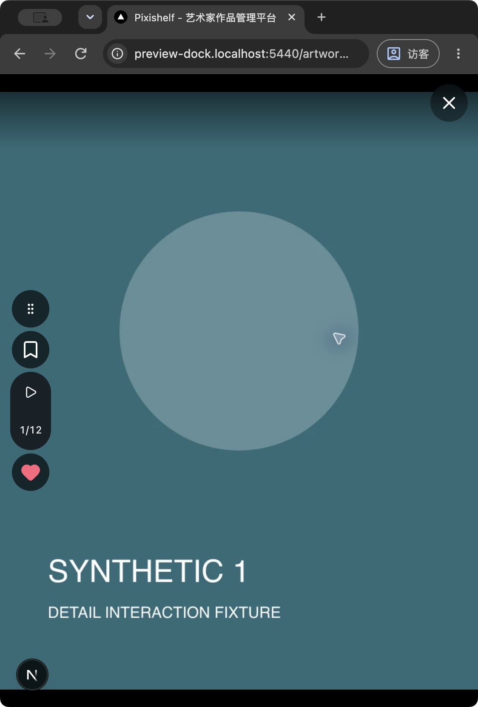
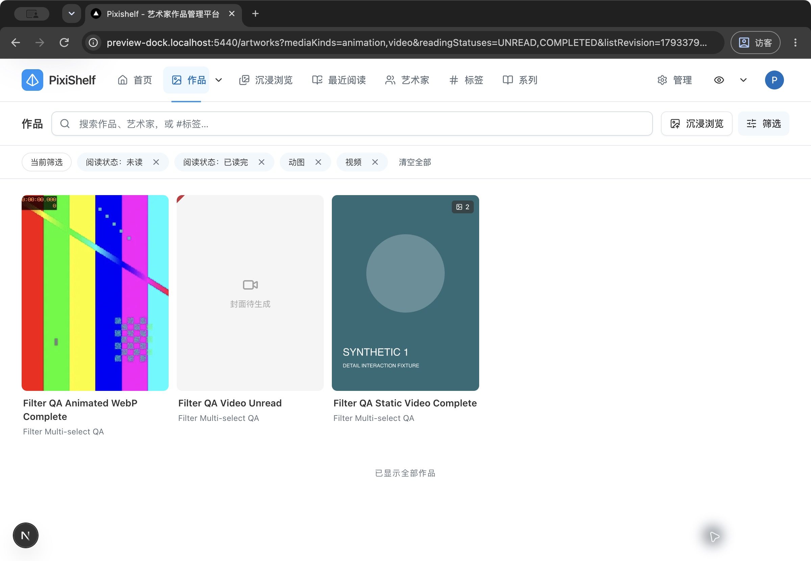

# 预览工具栏与多选筛选联合验证

适用版本为 `3b9f00a3`（v0.55.6）基线上的本地改动。本文记录本次检查，不代表 NAS 已部署或真机已验收。功能规则见[单图标记](../../features/media-marks.md)、[自动浏览](../../features/artwork-auto-browse.md)；筛选实现、126 项聚焦与 20 项隔离 PostgreSQL 证据见[多选筛选验证记录](./artwork-multiselect-2026-10-31.md)。本次不查询 GitHub 构建状态、不部署 NAS。

## 隔离环境

macOS、Node 20.19.4、Chrome 访客窗口；应用使用 `.local-data/preview-dock-20261031/app` 独立副本与独立 `.next`，监听 5440。临时 PostgreSQL 15 使用 `55435/preview_dock_fixture`，从空库部署 134 条现有 migrations；临时 ImgProxy 55436 只读挂载本任务合成媒体。未使用 db:push，不修改业务数据库、用户原媒体、5430 应用或其他既有服务。

两个合成账户、三位合成艺术家、十件作品：一件 12 媒体的预览样本，以及无媒体、静图、APNG、动画 WebP、视频、静图／视频、动画／视频、静态 WebP 和艺术家范围外静图。按账户设置合成 UNREAD／IN_PROGRESS／COMPLETED 阅读记录。初次筛选种子因 storagePath 唯一约束中止后，在预期部分完成状态下改用独立合成目录继续，未删改业务数据。

本次 CUA 浏览器连接列表为空，使用原生 Chrome AX／坐标操作；访客窗口和专用 `preview-dock.localhost` 子域隔离 Cookie、偏好和扩展。截图保留原生窗口上下文。原生鼠标／键盘操作不等于手机触摸；事件组合回归不等于真机。

## 浏览器批次与限制

- 桌面详情单击留在列表且未喜欢爱心隐藏；双击后出现可取消爱心。菜单“进入全屏阅读”沿用原适配预览，状态共享。
- 全屏画面双击出现同款落点浮心；书签、播放／计数、未喜欢按钮保留。工具栏把手可实时跟随原生拖动，键盘可停靠两侧／回底部；右停靠时桌面切图箭头在左侧。侧边计数打开向内设置，原播放、计数与设置仍可用。
- 作品列表先选择两组草稿并关闭，再打开仍未选中；应用“动图／视频”和“未读／已读完”后规范 URL 为 `mediaKinds=animation,video&readingStatuses=UNREAD,COMPLETED`，结果为预期三件。艺术家页独立从不限开始，同样组合返回范围内三件，沉浸入口保留 `scopeArtistId` 和两组选项。
- 原生窗口缩至移动断点以下（截图 1124×1662 物理像素，约 562px CSS 宽）后关闭并重开预览，发现保存的左停靠落在 (0,0)。根因是测量 effect 早于 Radix Portal 挂载，空 ref 导致未安装观察；桌面断点更新曾掩盖该问题。改为实际 DOM 节点挂载驱动测量后，同一窄窗刷新并重开，已保存的左停靠完整居中并避开安全边距，最终图通过主代理视觉复核。分端偏好和关闭重开的真实 Dialog 回归另有自动测试；没有把此前坏图计为通过。

DevTools 曾明确显示 390×844，但从打开中的预览在线切换到模拟设备后，原图、关闭按钮和工具栏整体几何未稳定，且原生 AX 点击无法可靠落到模拟设备目标。该截图 `.local-data/preview-dock-20261031/review/mobile-bottom.png` **不作为布局通过证据**，未把其原因确定为工具或实现；随后退出 DevTools，用关闭预览后的原生窄窗重新进入核验。真机多指缩放、手机原生拖动、iOS／Safari、手机横屏／桌面短高窗口的实际浏览器操作、NAS／NFS、弱网性能未测；短高窗口边界与 resize 由测量回归覆盖。筛选浏览器覆盖上述有限路径，预设保存／编辑与逐项清空由聚焦回归覆盖，没有另行宣称浏览器验收通过。









## 聚焦与联合检查

预览相关回归覆盖：双击局部坐标、已喜欢不重复保存／仍反馈、未就绪不假成功、控件排除、切图清理；详情隐藏／显露／取消／失败回退、账户隔离与虚拟重挂载；三锚点跟随／释放、7px 阈值、取消／丢失 capture、真实 Radix document 捕获 Escape、把手键盘停靠、内部按钮隔离、分端枚举记忆、无效／不可用 storage、resize／安全边界；横竖工具布局、向内设置 portal、单图 WebP 播放器和按钮节点不重挂载。侧边读取失败重试改为正常流，避免被工具栏滚动区域裁剪；横排保持原提示位置。

| 检查                                    | 结果                                                                                                                                                                              |
| --------------------------------------- | --------------------------------------------------------------------------------------------------------------------------------------------------------------------------------- |
| 主应用 `pnpm lint`                      | 0 warnings、0 errors；最后测试适配及把手焦点样式另做聚焦检查                                                                                                                      |
| 主应用 `pnpm typecheck`                 | Next typegen 与 TypeScript（含测试）通过；最后 Portal 修复后补 `pnpm exec tsc --noEmit` 通过                                                                                      |
| 提升权限 `pnpm run test --maxWorkers=2` | Portal 挂载修复前：479 文件通过、49 跳过；3567 tests 通过、351 跳过；总 528 文件／3918 tests，203.99s                                                                             |
| 最后 Portal 修复后聚焦回归              | hook 10、adaptive preview 20、reading dwell 2，共 3 文件／32 项通过；相关 3 文件 oxlint 0 warnings／0 errors                                                                      |
| 提升权限 `pnpm build`                   | 首次通过（Turbopack 19.4s）；最后 Portal 修复后第二次提升权限构建亦通过，编译、TypeScript 与页面收集成功                                                                          |
| 文档／图示与 diff                       | `pnpm docs:check`：358 Markdown 通过；`WEBP_BROWSER_CHANNEL=chrome pnpm docs:diagrams:check`：34 图源与 23 个内嵌 Mermaid 通过；`git diff --check` 通过，主应用大写路径检查无命中 |

图示检查首次因本机缺少 Playwright 默认 headless Chromium 可执行文件而未能启动；随后指定已安装的 Chrome channel 完成，不下载或安装浏览器。

首次默认并发、受限环境全量耗时 139.72s：470 文件／3555 项通过、49 文件／351 项跳过、9 文件／12 项失败。失败分别为两个旧筛选输出断言、两个预览测试的旧显隐断言／缺 matchMedia mock、三项默认 5 秒并发超时、五项本机 listen／tsx IPC EPERM。按正确规则修复旧断言和 mock；归档旧用例在提升权限、maxWorkers=2 的最小复验中为 0.7–1.4s，七文件 92 项通过，没有放宽超时或业务断言。上述受控全量随后通过，首次失败保留在本地日志中。此后浏览器才发现并修复 Portal 挂载时序，因此这次全量不代表最终修复后再跑；最终修复由真实 Dialog 首次 mobile／关闭重开、预览播放与阅读 32 项聚焦、类型检查、构建和同一窄窗截图确认覆盖，没有重复全量测试。

项目 `pnpm test` 原有配置排除 integration、jsdom e2e 与扫描 fixture integration；351 跳过主要为缺专用 PostgreSQL 测试 URL 的已有数据库套件。本次未宣称这些未跑套件通过。新增筛选 PostgreSQL 20 项及空库 migration 独立验证，不替代所有数据库套件。

最后修复聚焦命令（在 `packages/pixishelf`）：

```bash
pnpm exec vitest run 'app/artworks/[id]/_components/__tests__/use-preview-controls-dock.test.tsx' 'app/artworks/[id]/_components/__tests__/adaptive-media-preview.test.tsx' 'app/artworks/[id]/_components/__tests__/reading-neighbor-dwell.test.tsx'
```

## 清理与日志

本任务创建的 Chrome 访客窗口已关闭；独立应用 PID 15408（5440，cwd 为本任务副本）已终止，两个 `--rm` 容器 `pixishelf-preview-dock-20261031-db`／`pixishelf-preview-dock-20261031-imgproxy` 已停止且不再存在。5440／55435／55436 无监听；用户既有 5430 仍由 PID 79743 监听。仅保留本任务合成目录、脚本和证据，未删除业务资源。

本地原始材料：

- `.local-data/preview-dock-20261031/cleanup.json`：端口与清理核对；同目录 `review/` 保存本批次原始截图，包含不计通过的中间图。
- `/private/tmp/preview-dock-migrations.log`、`/private/tmp/preview-dock-dev.log`：隔离迁移与应用日志。
- `/private/tmp/pixishelf-20261031-unified-test.log`、`/private/tmp/pixishelf-20261031-failed-test-recheck.log`、`/private/tmp/pixishelf-20261031-final-test.log`：首次失败、最小复验与受控全量结果。
- `/private/tmp/pixishelf-20261031-build.log`、`/private/tmp/pixishelf-20261031-post-mobile-typecheck.log`、`/private/tmp/pixishelf-20261031-post-mobile-build.log`：首次构建、最后挂载修复后的类型与构建日志。

本任务仅完成源码、测试和文档；提交、patch tag 与推送由主代理按用户授权处理。
